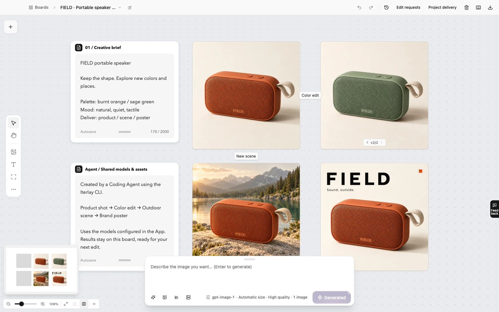
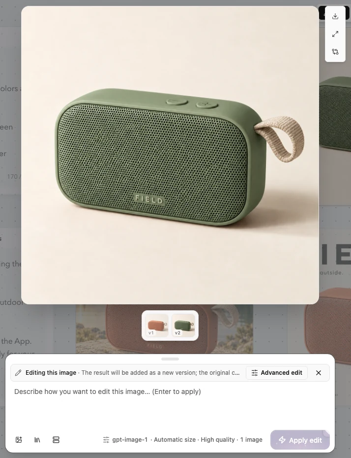
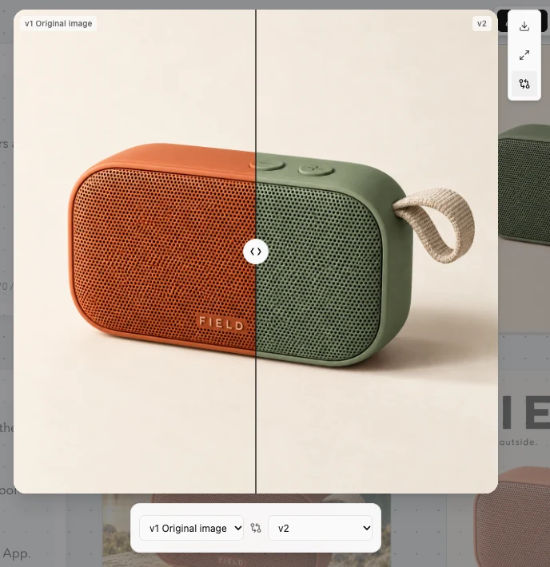

<div align="center">


# Iterlay

### Images, videos, and creative workflows. One canvas.

Iterlay is a free, open-source AI creative app. Generate images, refine the details, and make videos, with references, versions, and finished assets together on one canvas. Take an idea further without moving files between tools at every step.

**Images + video · Creative workflows · Your choice of models · Free & open source**

<p>
  <a href="https://github.com/Davied-H/iterlay/releases"></a>
  <a href="https://github.com/Davied-H/iterlay/stargazers"></a>
  <a href="https://github.com/Davied-H/iterlay/forks"></a>
  <a href="https://github.com/Davied-H/iterlay/releases"></a>
  <a href="LICENSE"></a>
  
</p>

[Download Iterlay](https://github.com/Davied-H/iterlay/releases) · [Website](https://davied-h.github.io/iterlay/en/) · [Agent workflow & example](https://davied-h.github.io/iterlay/en/agents/) · [简体中文](README.zh-CN.md)

</div>



One speaker, from a product shot to color exploration, an outdoor scene, and a brand poster. **Your references, experiments, and outputs stay together.**

Codex created this example through the Iterlay CLI using the App's configured model. Screenshots show the current browser workspace. See the [example assets, prompts, and production notes](docs/readme-example.md).

**Explore:** [The story](#the-story-from-a-whiteboard-to-a-shared-workspace-for-developers-and-agents) · [Features](#feature-checklist) · [Workflow](#start-with-an-image-build-a-set-of-assets) · [Get started](#get-started) · [Agent tools](#want-your-agent-to-help) · [FAQ](#faq)

## The story: From a whiteboard to a shared workspace for developers and agents

I'm a developer. Iterlay began with a straightforward wish: **I wanted somewhere as free-form as a whiteboard, where I could generate images and videos and gradually turn an idea into something real.**

Building a product involves more than code. A page needs imagery, a product needs a way to present itself, and a visual direction might lead to a short demo video. I wanted to work on those things around the project itself: references on one side, new experiments beside them, and room to keep developing the directions that felt right. Opening the workspace should let me see how an idea had taken shape.

### First, a whiteboard I could create on

What I like about a whiteboard is that I don't have to figure everything out before starting. I can put down a reference, write a few notes, and lay out several directions. I can step back to see the whole picture or focus on one image and keep working.

I wanted that freedom in AI creation. An image on the canvas should be something I could keep editing. An experiment worth keeping should have a version I could return to. A still image could become the starting point for a video. With text, images, and video in one space, the creative process would have a visible thread I could follow and revisit.

That was Iterlay's first starting point: bring generation into a whiteboard-style workspace, with somewhere to continue creating after the first result.

### Trying other tools revealed another missing piece

Along the way, I tried other whiteboard-style AI image tools. Laying out references and results on a canvas felt close to the way I wanted to work. But when it came time to generate something, I ran into a more immediate problem: **I knew what I wanted to make, but I wasn't good at writing professional prompts.**

As a developer, I can describe what a page needs and judge whether an image feels right. Translating that into composition, lighting, materials, and style instructions a model can follow is harder. The canvas gave me room to arrange ideas, but I still hesitated at the prompt box. How should I describe this? What information is missing? If the result is wrong, what should I change next?

I began to feel that Iterlay also needed an AI assistant I could think things through with. I wanted to start in my own words, have it help clarify the goal and ask about important details, and gradually turn a rough idea into actionable generation instructions. With references and results nearby, the conversation could keep building on them.

I wanted creation to begin with “I'd like to make something like this,” with the more specialized language taking shape through the conversation.

### A chance encounter brought Pi Agent into the picture

While thinking about this, I happened to come across Pi Agent, an agent tool that was attracting attention at the time. It made me wonder: could I bring it into Iterlay, so an assistant could work with the creative context, use the workspace's tools, and help me carry an idea forward?

I integrated Pi Agent and began building Iterlay's creative assistant around it. The whiteboard holds references, images, videos, and versions; the assistant provides a place to discuss ideas, clarify requests, and connect that conversation to tools.

That made the original whiteboard idea more complete. I wanted room to explore freely, and help figuring out the next step when I didn't know how to describe it or where to go from there.

### Then, I wanted to use it while writing code

As a developer, I also wanted to do this directly from coding agents, especially Codex and Claude Code.

When I'm building a page or implementing a feature with an agent, visual assets are already part of the task. I wanted to continue the same conversation: “Make an image that fits this page,” or “Create a few images and a video around this product direction.” The agent could use generation tools and bring the assets into the project, while I could open the canvas to review, compare, and decide what to change next.

Both ways of working mattered to me: the freedom to look and adjust things myself on a whiteboard, and the ability to ask an agent to use those same capabilities. The models I had chosen, the references I had collected, and the results already created should carry across both.

### The canvas and the terminal became one workspace

The whiteboard, the need for a creative assistant, and the wish to generate assets directly from coding agents gradually came together as Iterlay.

In the App, I can arrange references, generate images, refine details, compare versions, and explore video. In Codex or Claude Code, an agent can use the CLI and Skills to call the configured models, create assets, organize boards, and export files into a development project. The work connects through the same local workspace.

I can find a visual direction on the canvas and ask an agent to continue making assets. Or I can ask the agent for several candidates, then return to the canvas to choose and refine them. I can move between visual judgment and tool execution as the task develops.

**That's why I'm building Iterlay: a whiteboard where I can generate images and videos, an AI assistant that helps me articulate my ideas, and tools that let my coding agents join in — making visual creation part of the development process.**

## Why Iterlay?

### Take an image further. Turn it into video.

Keep references, generated images, and videos on one infinite canvas. Create an image, refine it, then turn it into video with a supported model. Keep the assets together so you can pick up where you left off.

Creative workflows connect references, generation, edits, comparisons, and delivery. Work directly on the canvas, or let an agent handle individual steps.

### Choose your models. Reuse your setup.

Bring your own API keys or authorize a Codex account. Choose image, video, and chat models for different tasks, with multiple providers in one workspace. Agents can reuse the models and credentials already configured in the App.

### Bring your agent into the workflow.

Give Codex, Claude Code, and other coding agents CLI tools and a Skill to generate images, edit assets, create videos, arrange boards, and export files. Review and adjust results on the canvas, or have your agent export assets into the project you are building.

### Local workspace. Free, open-source tools.

Boards and assets are stored on your computer. Original code for the desktop app, canvas, AI integrations, CLI, and website is MIT licensed, so you can modify and build it yourself. The app is permanently free, with no activation required; model providers charge for their usage. When you use a remote model, prompts and required reference assets are sent to that provider.

## Feature checklist

The following capabilities are implemented in this repository. Experimental areas are labeled; individual model capabilities and availability in older installers can differ.

### 🧭 Canvas & workspace

- [x] Infinite canvas with pan, zoom, fit-to-view, and a minimap.
- [x] Image, text, and video nodes; group related material and connect nodes visually.
- [x] Move, resize, duplicate, and arrange images in rows, columns, or grids.
- [x] Multiple boards with search, sorting, and card/list views.
- [x] Undo/redo, local autosave, and an image trash with restore.

### 🎨 Image generation & editing

- [x] Text-to-image generation and reference-image workflows.
- [x] Continue editing an existing image through natural-language instructions.
- [x] Image editing assistant to clarify the change before generation.
- [x] Annotation/mask edit briefs for describing local changes and handing them to an agent.
- [x] Per-node image versions, version switching, and slider comparison.
- [x] Provider/model selection, generation settings, and task history.

### 🎬 Video creation

- [x] Text-to-video and image-to-video with supported providers.
- [x] Model-dependent first/last frames, video remix, and extension.
- [x] Import video, view it on the board, and track generation tasks.
- [x] Video sequence editor with clip ordering and MP4 / H.264 export.

### 🧩 Templates & reusable workflows

- [x] Create, organize, import, and export reusable visual templates.
- [x] Extract a reusable template from an image with a configured text model.
- [x] Template assistant and reference-aware prompt composition.
- [x] Keep reusable directions alongside project-specific experiments.

### 📦 Assets & delivery

- [x] Import images and organize assets across boards and the asset library.
- [x] Slice images into separate reusable assets.
- [x] Download individual results or export selected assets as a ZIP.
- [x] Export/import board packages (`.itb`) to carry a workspace into another installation.
- [x] Export WeChat sticker assets, including static and animated GIF workflows.

<details>
<summary><strong>🤖 Coding agents, model connections & experimental extensions</strong></summary>

#### Coding agent tools

- [x] Bundled CLI and installable Skills for Codex and Claude Code.
- [x] Reuse the App's saved model providers and authorization.
- [x] Generate/edit images, generate/import video, and inspect task status.
- [x] Inspect boards, arrange assets, switch versions, and export deliverables.
- [x] Read and claim annotation edit briefs, then attach completed results.
- [x] JSON output and discoverable operation schemas through `iterlay tools list --json`.

#### Model connections & local workspace

- [x] Multiple image/video providers and OpenAI-compatible text models.
- [x] API-key connections and Codex account authorization.
- [x] Local board and asset storage, English/Chinese interface, and theme settings.
- [x] macOS and Windows packaging configurations; actual installers are listed in Releases.

#### Experimental extensions

- [x] Tool plugin installation, enable/disable, removal, and local `.iterlay-plugin` import.
- [x] Official short-drama assistant: story, characters, storyboards, and production views.
- [x] Image reconstruction workflow with layer asset and PSD export.

The plugin catalog currently ships with the App. A public third-party online marketplace, provider-plugin runtime, and automatic plugin updates are not implemented. Reconstruction quality depends on the source and configured services; it is not a promise to recover an original design file. See the [plugin guide](docs/plugins.md).

</details>

## Start with an image. Build a set of assets.

### 1. Start with a reference

Import an existing image or generate one from a prompt. Keep style references, product images, and candidate directions together to guide your next step.

### 2. Refine on the canvas

Select a result and describe the background, object, or style you want to change. The image editing assistant uses the current image to help clarify what should change and what should stay.



### 3. Compare before you commit

Change the product from burnt orange to sage green while keeping the original and edited image in the same node. Drag the comparison slider to inspect the changes before choosing a version.



### 4. Set your image in motion

Choose an image you like and turn it into video with a supported model, or describe a scene to generate video from text. Keep images and videos on the same board as you explore.

### 5. Organize and deliver

Keep references, images, videos, and versions organized by project. Export the assets you need for product presentations, content, design, or development. Slice images into smaller reusable assets when needed.

## Made on this canvas

<table>
<tr>
  <td width="50%"><br /><sub>Product shot</sub></td>
  <td width="50%"><br /><sub>Color edit</sub></td>
</tr>
<tr>
  <td width="50%"><br /><sub>Outdoor scene</sub></td>
  <td width="50%"><br /><sub>Brand poster</sub></td>
</tr>
</table>

One product, four directions. These are real Iterlay outputs from the same example workflow; the green image is an edit of the orange original. [See the prompts and production notes](docs/readme-example.md).

## What can you make?

- **Product and commerce visuals:** Explore scenes, backgrounds, and lighting from a product reference, then compare presentation options.
- **Content and brand assets:** Create posters, covers, and social graphics with references and candidate directions on the same board.
- **Assets for design and development:** Ask your coding agent to generate illustrations, backgrounds, and images, then export them into your project.
- **Image-to-video:** Turn a product image or scene into a moving version, then review and organize still and video assets together.

## Get started

1. **Install Iterlay.** Choose your system on the [download page](https://davied-h.github.io/iterlay/#/download). Available installers are listed in [GitHub Releases](https://github.com/Davied-H/iterlay/releases).
2. **Connect your models.** Add providers, API keys, and models in settings, or authorize a Codex account.
3. **Create your first board.** Import a reference or enter a prompt, then select the result to keep refining.

### Supported model services

- **Image generation and editing:** OpenAI-compatible endpoints, OpenRouter, Alibaba Cloud Bailian, Volcengine Ark, Poe, fal.ai, Codex OAuth.
- **Video generation:** Volcengine Ark, fal.ai, OpenRouter, MiniMax.
- **Chat and creative assistance:** OpenAI-compatible endpoints, Codex OAuth.

Configure these capabilities separately. Image editing, references, text-to-video, image-to-video, and available parameters depend on the selected model and API. A provider integration does not imply support for every capability. Iterlay does not sell hosted model credits or top-ups.

## Want your agent to help?

See the [FIELD walkthrough](https://davied-h.github.io/iterlay/en/agents/) for the finished sample website, an importable board with real images and version history, and copyable tasks for setup, creation, and delivery. Opening the example does not run a model; creating new images uses your configured provider.

Let Codex or Claude Code create visual assets as part of your existing workflow.

Install and open Iterlay, configure a model, then install the Skills from **Settings → Coding Agent**, or run:

```bash
npx iterlay add --agent codex
# Or: npx iterlay add --agent claude-code
```

Then give your agent a concrete task:

> Use Iterlay to create a visual set for the FIELD portable speaker: start with an orange product shot, then explore a green colorway, an outdoor scene, and a brand poster. Arrange the results on one board and export them into the project's assets directory.

The App installs its bundled CLI on first launch. Agents use Skills to call the CLI with the providers and authorization already saved in the App. The current integration uses **CLI + Skill**; migration removes that agent's old Iterlay MCP configuration.

You can also use the CLI directly:

```bash
iterlay image generate --prompt "A warm, minimalist illustration of a coffee cup" --out ./coffee.png --json
iterlay image edit --input ./coffee.png --prompt "Make the cup off-white" --out ./coffee-light.png --json
```

See the [CLI and agent integration guide (Chinese)](cli/README.md) for more.

## FAQ

<details>
<summary><strong>Is Iterlay free? Do I need an activation code?</strong></summary>

The App is permanently free and needs no activation. Its original code is MIT licensed. Model calls are billed by the provider you choose; Iterlay does not sell model credits.

</details>

<details>
<summary><strong>Can I use it without a coding agent?</strong></summary>

Yes. Use the desktop canvas directly to import, generate, edit, compare, and export. CLI and Skills are optional ways to automate the same workspace.

</details>

<details>
<summary><strong>Is it offline? Where does my work go?</strong></summary>

Boards and assets are stored locally. Remote generation and chat require network access and send the relevant prompts and reference assets to your chosen provider. Local storage does not make a remote model run offline.

</details>

<details>
<summary><strong>Does every listed provider support every feature?</strong></summary>

No. Image edits, reference limits, transparent output, video duration, first/last frames, remix, and extension depend on the provider and model. Configure image, video, and text capabilities separately.

</details>

<details>
<summary><strong>Can I try the example without paying for a generation?</strong></summary>

Yes. Open the [finished FIELD website](https://davied-h.github.io/iterlay/en/agents/) or import its [board package](website/public/examples/field/field-starter.itb). Viewing the existing assets does not call a model. Generating a new version uses your configured provider.

</details>

<details>
<summary><strong>Is the browser development mode a hosted web app?</strong></summary>

No. `pnpm dev` runs a browser frontend backed by a local hidden Electron service, with separate development data. Desktop installers are the regular end-user entry point.

</details>

## Community & project activity

Found a bug? [Open an issue](https://github.com/Davied-H/iterlay/issues/new). Have a useful workflow? Share your board, prompts, and results in an issue or contribute an example through a PR. Stars help other creators discover the project.

<picture>
  <source media="(prefers-color-scheme: dark)" srcset="https://api.star-history.com/svg?repos=Davied-H%2Fiterlay&amp;type=Date&amp;theme=dark" />
  <source media="(prefers-color-scheme: light)" srcset="https://api.star-history.com/svg?repos=Davied-H%2Fiterlay&amp;type=Date" />
  
</picture>

[Explore the interactive star history](https://www.star-history.com/#Davied-H/iterlay&Date) · [Releases](https://github.com/Davied-H/iterlay/releases) · [Contributors](https://github.com/Davied-H/iterlay/graphs/contributors)

<sub>Badges and charts refresh through third-party services and GitHub's image cache; they are not second-by-second telemetry. README views count image loads from this counter's setup onward, including verification loads, not unique visitors or historical GitHub traffic. Downloads count release asset downloads, not active users.</sub>

## Develop and contribute

Requires Node.js **22.12+** and **pnpm 10**. On macOS, install Xcode Command Line Tools as well.

```bash
pnpm install
pnpm dev
```

Open **http://127.0.0.1:5180** to develop against the real workspace in your browser. This starts a hidden Electron backend service and keeps development data separate from the installed App.

[Development, checks, and packaging](docs/development.md) · [Engineering notes (Chinese)](docs/engineering.md) · [Contribution guide (Chinese)](CONTRIBUTING.md) · [Plugin development (experimental, Chinese)](docs/plugins.md)

Share bugs and use cases through [Issues](https://github.com/Davied-H/iterlay/issues), or contribute a pull request. If Iterlay helps you create something, give it a Star or share your board and process so others can see what it can do.

## License

Original project code is available under the [MIT License](LICENSE). Third-party dependencies and assets retain their respective licenses; see [Third-party notices](THIRD_PARTY_NOTICES.md).
