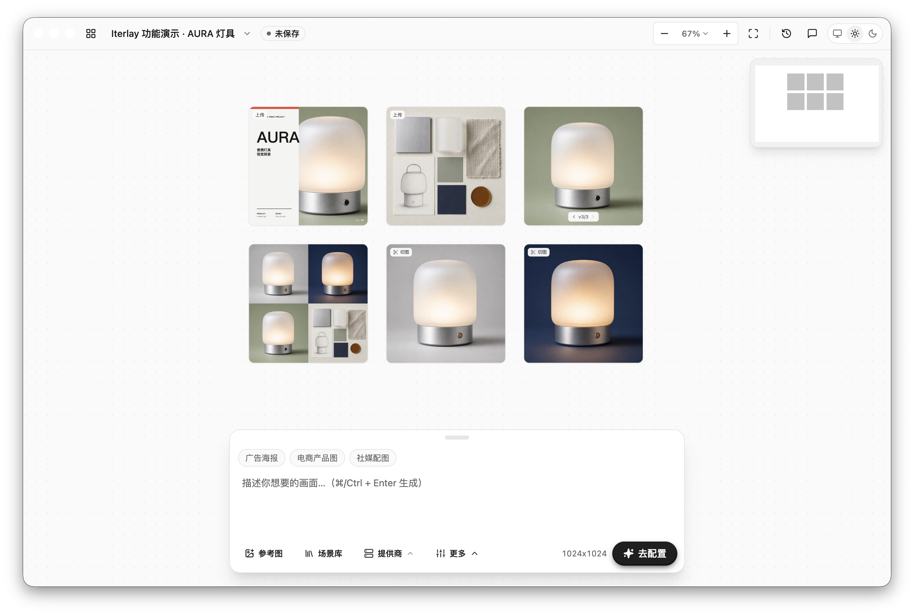

# Iterlay

**A bring-your-own-key AI visual workspace where you and your agents generate and refine images and videos on an infinite canvas.**

English · [简体中文](README.zh-CN.md)

<!-- Add a 60–90 second real workflow recording here: start a generation, show the actual wait, revise the result, and show final image and video outputs. Label any speedups or cuts. Do not substitute animations or a screenshot slideshow for real use. -->

## Download and get started

[Download installers](https://github.com/Davied-H/iterlay/releases) · [Choose your platform](https://davied-h.github.io/iterlay/#/download) · [Website](https://davied-h.github.io/iterlay/)

1. Download an installer for your system, install it, and open Iterlay. Releases determine build availability; the download page groups builds for Apple silicon, Intel Macs, and Windows x64.
2. Configure your AI providers, API keys, and models in settings. No activation or trial is required.
3. Create a board and enter a prompt to generate an image or video. Use a result as a reference to continue refining your work.

To let Codex or Claude Code work with your canvas, install the desktop app, then run:

```bash
npx iterlay add
```

The App installs the Iterlay CLI automatically. Coding agents use its bundled Skill to generate images and videos with saved providers and manage the workspace. See the [agent integration guide (Chinese)](cli/README.md).

## Chat, Image, and Video providers

- **Chat (conversation and creative assistance):** OpenAI-compatible endpoints, Codex OAuth.
- **Image (generation and editing):** OpenAI-compatible endpoints, OpenRouter, Alibaba Cloud Bailian, Volcengine Ark, Poe, fal.ai, Codex OAuth.
- **Video (generation):** Volcengine Ark, fal.ai, OpenRouter, MiniMax.

Configure these capabilities separately: a provider integration does not imply support for all three. Custom endpoints require the corresponding service URL, API key, and model; Codex OAuth uses account authorization. Image editing, text-to-video, image-to-video, and available parameters depend on the selected model and API. Your providers bill usage of your own keys.

## Open source and services

Iterlay is permanently free, with no activation or trial requirements. Original code for the desktop app, canvas, AI integrations, CLI, and website is licensed under MIT.

The client does not offer hosted Iterlay model services, credits, or purchase flows. Configure your own model providers using API keys or a Codex account; the respective providers bill model usage. Updates and installers are delivered through GitHub Releases, without the paid edition's licensing, account, or update services.

## The canvas workflow



- **Infinite canvas:** Keep images, references, and results together with their context.
- **Generate and refine:** Create images and videos with AI, then iterate using reference material.
- **References and slicing:** Bring existing images into your workflow and split them into reusable assets.
- **Versions and history:** Compare image versions and review past generations.
- **Asset organization:** Organize creative materials across boards and your workspace.

## Local development

Requirements:

- Node.js **22.12+** and **pnpm 10**.
- On macOS, Xcode Command Line Tools (`xcode-select --install`). The native image-layer component uses the macOS 14 SDK.

```bash
pnpm install
pnpm dev
```

Open **http://127.0.0.1:5180** in your browser. `pnpm dev` (or `pnpm dev:web`) starts Vite and a hidden Electron service process, so the browser uses real boards, settings, generation tasks, and native media services. Renderer changes use Vite hot reload; changes to Electron services rebuild and restart the backend. Stop everything with Ctrl+C.

Backend restarts and shutdown wait for pending board saves. If the workspace stays open because saving failed, development services remain available and automatic restarts pause. Resolve the save error in the browser, then press Ctrl+C again; the launcher never force-kills the workspace.

Browser development stores its data separately in `tmp/browser-dev/user-data/`; existing app data stays separate. Set `ITERLAY_BROWSER_DEV_USER_DATA` to choose another development directory. The authenticated bridge listens on loopback and starts only in this development mode. Packaged apps keep using Electron IPC.

Use the browser for routine debugging and verification. Run `pnpm electron:dev` for visible desktop app testing only when explicitly requested, including native window and application lifecycle behavior. `pnpm dev:ui` retains the standalone Vite server for isolated UI previews without backend services.

Run the project checks:

```bash
pnpm setup:subprojects
pnpm check:all
```

`setup:subprojects` installs the CLI and website dependencies using their own lockfiles. `check:all` covers type checks, lint, tests, and builds across all four projects. Use `pnpm typecheck`, `pnpm lint`, or `pnpm test` for focused checks. After building Electron, run `pnpm bench:storage` for a storage benchmark with temporary fixtures. See the [engineering notes (Chinese)](docs/engineering.md) for module boundaries, persistence formats, compatibility, and measured results.

### Repository layout

- `src/` — React canvas and desktop interface.
- `electron/` — Electron main process and desktop services.
- `cli/` — Coding-agent integration CLI and its [documentation](cli/README.md).
- `website/` — Product website and download page; see its [development guide (Chinese)](website/README.md).
- `resources/` — Bundled skills, icons, and native resources.
- `docs/` — Product notes and maintainer documentation.

## Contributing

Report bugs through [GitHub Issues](https://github.com/Davied-H/iterlay/issues) or submit improvements via pull requests. Read the [contribution guide (Chinese)](CONTRIBUTING.md) before contributing.

## Local packaging

```bash
pnpm build
pnpm package
```

`pnpm package` creates an application directory under `release/`. `pnpm release` builds an unsigned, unnotarized macOS ARM64 DMG using UDZO compression. Use `pnpm release --platform mac --arch all` on macOS for ARM64 and Intel x64 DMGs, or `pnpm release --platform win --arch all` in Git Bash on Windows for separate ARM64 and x64 NSIS installers. `--arch arm64` and `--arch x64` build a single architecture. The manually dispatched `Build desktop release packages` workflow runs this same script for all four variants. Packaging audits exclude development modules, renderer-only dependency trees, production JavaScript source maps, and bundled FFmpeg; app and ASAR budgets are 380 MiB and 120 MiB. Reports are saved to `output/package-size/`. These commands and the workflow do not publish a GitHub Release.

The app downloads its video tools only after asking on the first operation that needs them. The versioned component comes from GitHub Releases, is verified with SHA-256, and is stored under Electron's user-data directory at `tools/ffmpeg/ffmpeg6-r1/darwin-arm64/`. Once installed, it works offline and survives app updates. A failed or cancelled download prevents a new sequence generation from being submitted or charged. Image work and ordinary startup do not download the component.

Maintainers build the component separately on an Apple silicon Mac with Xcode Command Line Tools and `brew install pkgconf`:

```bash
pnpm media-tools:build --version ffmpeg6-r2
pnpm media-tools:verify
```

This compiles pinned FFmpeg 6.0 and x264 sources without nonfree components and retains the existing codec configuration. The archive under `output/media-tools/<version>-darwin-arm64/` contains both executables, licenses, matching source archives, and build information. The build writes exact archive/file hashes into `shared/media-tools-manifest.json`. Component revisions are immutable: use a new `--version` for each changed build. With no arguments, the command verifies and reuses a matching local archive; `--rebuild` writes an isolated diagnostic candidate and refuses to change a pinned version's hashes. The current `ffmpeg6-r1` asset is `iterlay-media-tools-ffmpeg6-r1-darwin-arm64.zip` on GitHub Release `media-tools-ffmpeg6-r1`. Publish each new component before shipping an app that references it; publishing is a separate maintainer action. Other platforms lack complete packaging dependencies. Maintainers must configure signing, notarization, and distribution themselves. See [Third-party notices](THIRD_PARTY_NOTICES.md).

## License

Original project code is available under the [MIT License](LICENSE). Third-party dependencies and assets retain their respective licenses; see [Third-party notices](THIRD_PARTY_NOTICES.md).
