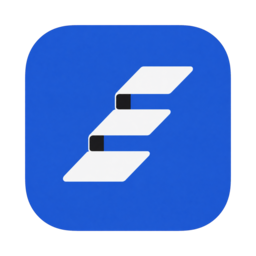
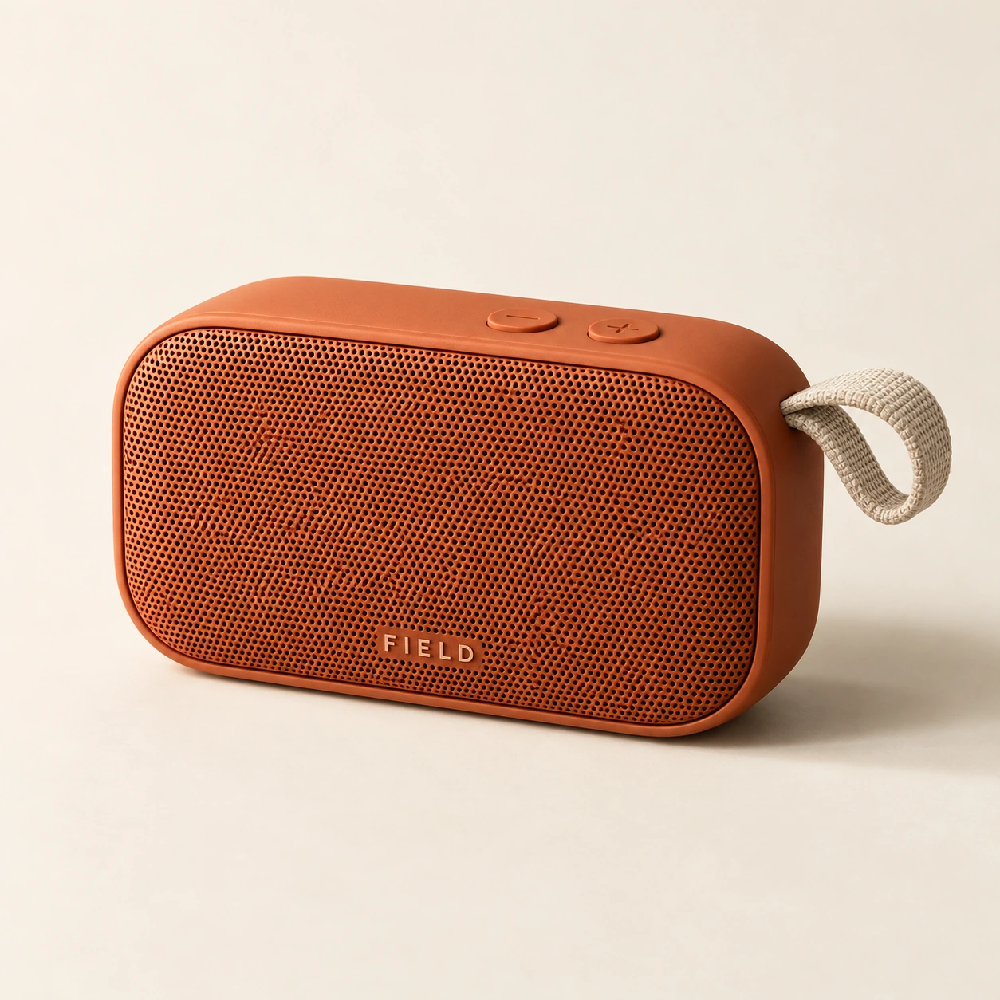
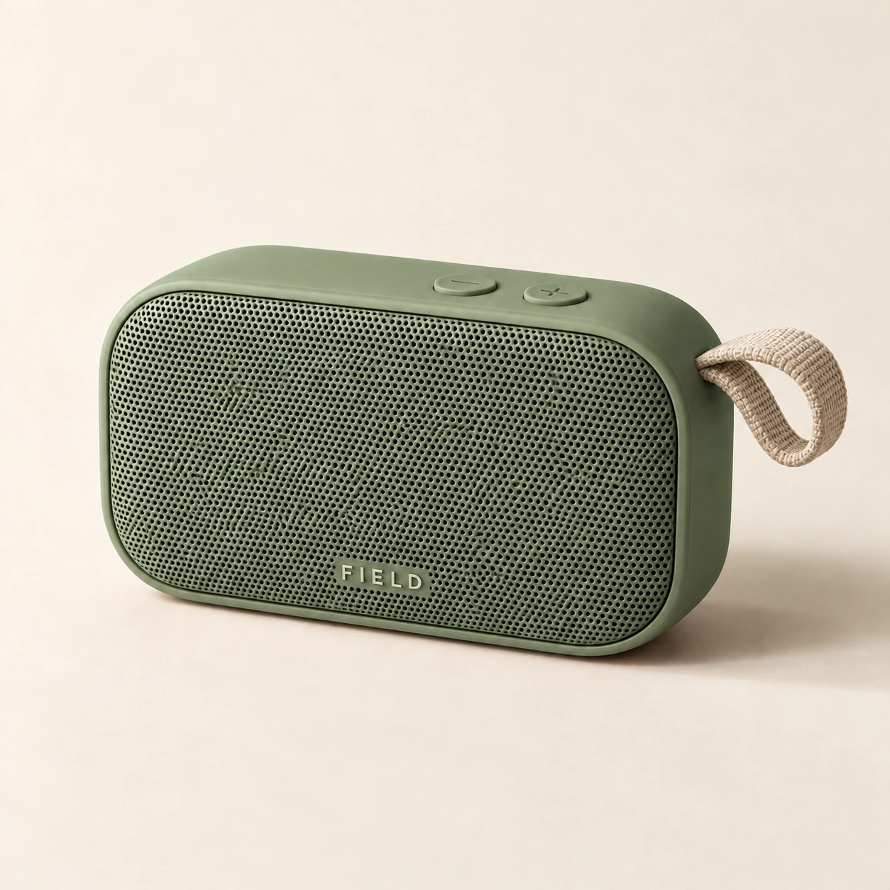
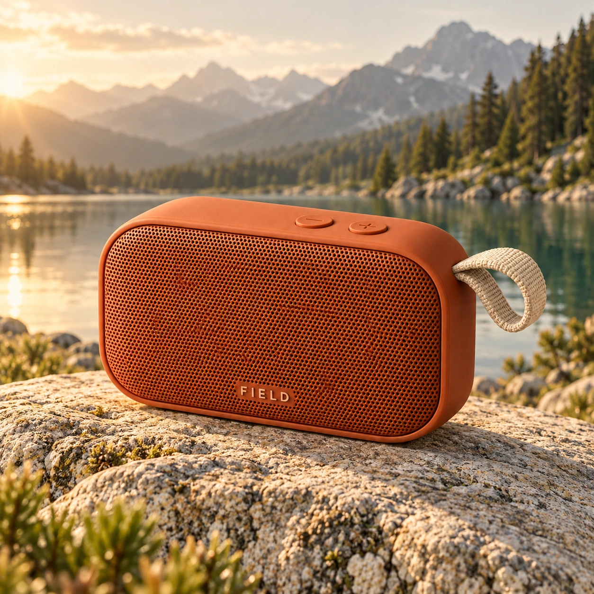
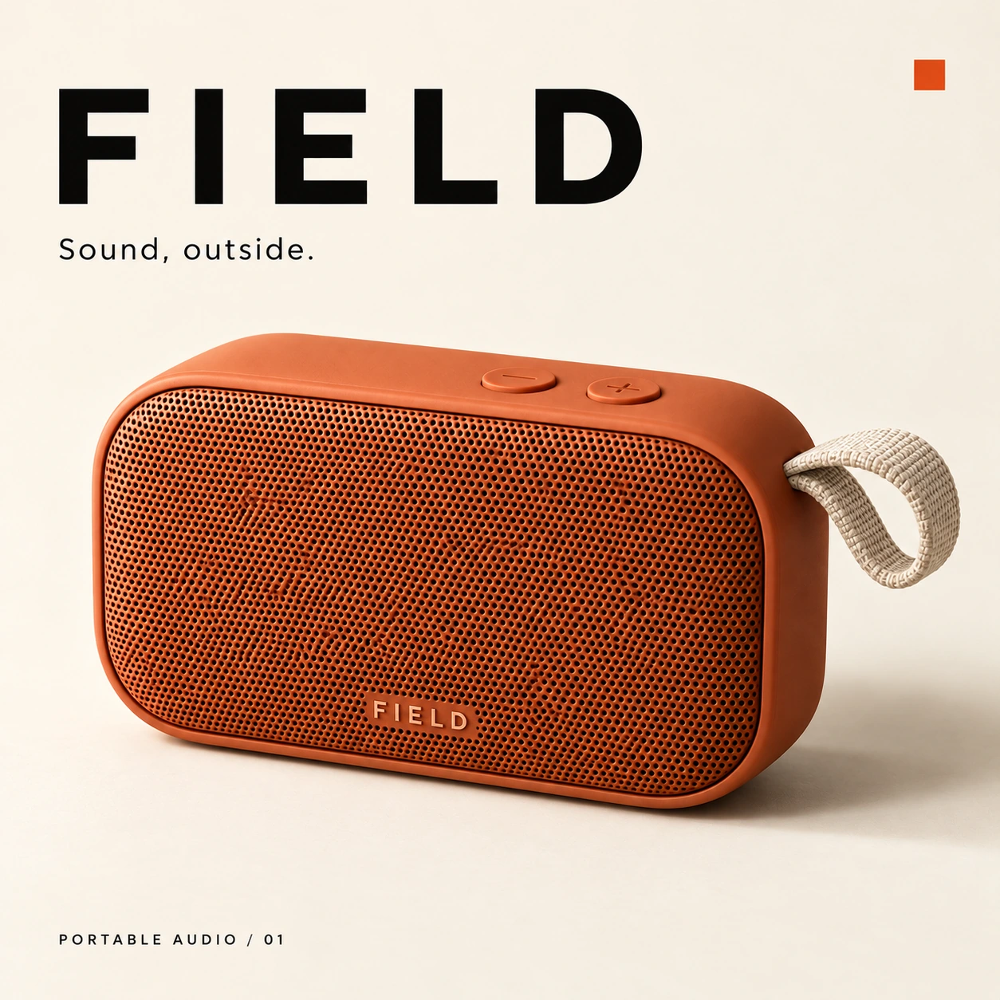

<div align="center">



# Iterlay

### 图片、视频与创作工作流，一张画布串起来。

Iterlay 是免费开源的 AI 创作 App。生成图片、修改细节、制作视频，再把参考、版本和成品整理在同一张画布上。从一个想法到一套素材，接着做，不用来回搬。

**图片 + 视频 · 创作工作流 · 自选模型 · 免费开源**

<p>
  <a href="https://github.com/Davied-H/iterlay/releases"></a>
  <a href="https://github.com/Davied-H/iterlay/stargazers"></a>
  <a href="https://github.com/Davied-H/iterlay/forks"></a>
  <a href="https://github.com/Davied-H/iterlay/releases"></a>
  <a href="LICENSE"></a>
  
</p>

[下载 Iterlay](https://github.com/Davied-H/iterlay/releases) · [官网](https://davied-h.github.io/iterlay/zh/) · [Agent 工作流与案例](https://davied-h.github.io/iterlay/zh/agents/) · [English](README.md)

</div>


一台音箱，从产品主图到配色探索、户外场景与品牌海报。**参考、尝试和结果，都留在同一个创作空间里。**

本例由 Codex 通过 Iterlay CLI 调用 App 已配置的模型完成，截图来自当前网页工作台。查看[示例素材、提示词与制作说明](docs/readme-example.md)。

**快速导航：** [产品故事](#产品故事从一张白板到开发者与-agent-共用的创作空间) · [功能清单](#已实现功能清单) · [创作流程](#从一张图开始做出一套素材) · [开始使用](#开始使用) · [Agent 工具](#想让-agent-帮忙也可以) · [常见问题](#常见问题)

## 产品故事：从一张白板，到开发者与 Agent 共用的创作空间

我是一个开发者。Iterlay 最初来自一个很直接的愿望：**我想要一个像白板一样自由的地方，可以在里面生成图片、生成视频，把想法一点点做出来。**

开发一个产品，写代码只是其中一部分。页面里的配图、产品的展示图、一个想试试的视觉方向，甚至一段演示视频，都会成为创作的一部分。我希望这些东西能够围绕正在做的项目展开：参考图放在一边，新的尝试放在旁边，满意的方向继续往下做。打开工作区，就能看见这个想法是怎样一步步长出来的。

### 先有一张可以创作的白板

白板吸引我的，是它不要求人在开始之前就把一切想清楚。可以先放一张参考，写几句说明，再摆上几个不同的方向；退远一点看整体，也可以靠近一张图继续琢磨。

我想把这种自由带到 AI 创作里。画布上的图片应该能接着修改，某一次尝试值得保留，就留下一个版本；静态画面有了感觉，也可以沿着它继续生成视频。文字、图片和视频待在同一个空间里，创作过程就有了可以看见、可以回头的脉络。

这成为 Iterlay 的第一个出发点：把生成能力放到白板式的工作区里，让一次生成之后，还有地方继续创作。

### 试过其他工具后，我发现自己缺的还有一个助手

带着这个想法，我也体验了一些白板式的 AI 图片生成工具。把参考和结果铺在画布上，确实很接近我想要的创作方式。但真正开始生成时，我又遇到了一个更直接的问题：**我知道自己想做什么，却不太会写专业的提示词。**

作为开发者，我可以描述一个页面需要什么，也能判断一张图是不是自己想要的感觉。可要把这些想法变成模型容易理解的构图、光线、材质和风格描述，就没那么顺手了。画布给了我摆放想法的自由，提示词输入框前的犹豫却还在：应该怎么说？需要补哪些信息？结果不对，下一步又该改哪里？

我开始觉得，Iterlay 里还需要一个能一起商量的 AI 助手。我可以先用自己的话说出想法，它再帮我理清需求、追问关键细节，把模糊的感觉整理成可以执行的生成指令。参考和结果就在旁边，对话也能围绕它们继续。

我希望创作可以从“我想做一个这样的东西”开始，专业的表达则在交流中逐渐补齐。

### 一次偶然遇见，让 Pi Agent 加入了进来

就在思考这件事的过程中，我偶然看到了 Pi Agent。这个当时受到不少关注的 Agent 工具，让我开始琢磨：能不能把它接进 Iterlay，让助手结合创作上下文，使用工作台里的工具，陪我把一个想法往下做？

于是，我把 Pi Agent 加了进来，也开始围绕它搭建 Iterlay 的创作助手。白板承载参考、图片、视频和版本，助手则成为交流想法、梳理需求与衔接工具的入口。

这一步让最初的白板愿望更完整了：我既需要一个自由探索的空间，也需要有人在我不知道怎么描述、怎么继续的时候，帮我把下一步想清楚。

### 后来，我也希望在写代码的时候使用它

作为开发者，我还希望从 Coding Agent 里直接完成这些事，尤其是在 Codex 和 Claude Code 中。

当我正在和 Agent 一起开发一个页面，或者实现一个产品功能时，视觉素材本来就是任务的一部分。我希望能顺着当前的工作继续说：“帮这个页面做一张合适的配图”，或者“根据这个产品方向，做几张图片和一段视频”。Agent 能使用生成工具，把结果带回项目，我也能打开画布查看、比较，再决定下一步怎么改。

这里有两个同样重要的愿望：自己创作时，能在白板上自由地看和调整；交给 Agent 时，它也能操作同一套能力。已经选好的模型、已有的参考和生成结果，应该能在这两种使用方式之间接着用。

### 于是，画布和终端走进了同一个工作区

对白板的期待、对创作助手的需要，以及在 Coding Agent 中直接生成素材的愿望，逐渐汇成了现在的 Iterlay。

在 App 里，我可以亲自摆放参考、生成图片、修改细节、比较版本，继续探索视频；在 Codex、Claude Code 里，Agent 可以通过 CLI 与 Skill 调用已配置的模型，生成素材、整理画板，再把需要的文件导出到开发项目。两边的工作能够在同一个本地工作区里衔接起来。

我可以先在画布上找到一个视觉方向，再让 Agent 接着完成素材；也可以先让 Agent 生成几个候选，再回到画布里挑选和调整。需要亲自判断的时候看画布，需要执行的时候用工具，创作可以随着任务自然地来回切换。

**这就是我做 Iterlay 的原因：给自己一张能生成图片和视频的白板，一个能帮我把想法说清楚的 AI 助手，也给 Coding Agent 一套能参与其中的工具，让视觉创作真正成为开发过程的一部分。**

## 为什么用 Iterlay？

### 图片到视频，围绕同一个项目创作

把参考图、生成图片和视频放在同一张无限画布上。先做一张图，修改满意后，再用支持的模型生成视频。每一步的素材都留在项目里，方便接着创作。

创作工作流把参考、生成、修改、比较和交付连起来。你可以亲自操作，也可以让 Agent 接手其中的步骤。

### 模型自己选，配置可以复用

接入自己的 API Key 或 Codex 账号授权，按任务选择图片、视频和对话模型。在同一个工作台中使用不同供应商，Agent 也能复用 App 已保存的模型配置与授权。

### 也能交给 Agent，替你接着做

通过 CLI 和 Skill，让 Codex、Claude Code 等 Coding Agent 生成图片、修改素材、制作视频、整理画板并导出文件。你可以在画布上查看和调整结果，也可以让 Agent 将素材导出到正在开发的项目。

### 工作区保存在本地，工具开源免费

画板与素材保存在本机。桌面端、画布、AI 集成、CLI 和官网的原创代码均采用 MIT 许可证，可自行修改和构建。应用永久免费，无需激活；模型调用费用由对应供应商收取。使用远程模型时，提示词和所需参考素材会发送给所选服务。

## 已实现功能清单

以下能力已在本仓库实现，实验功能单独标注。具体模型支持范围及旧版安装包中的可用功能可能不同。

### 🧭 画布与工作区

- [x] 无限画布：平移、缩放、适配视图与小地图。
- [x] 图片、文本、视频节点，支持分组与视觉连线。
- [x] 图片移动、缩放、复制，横向、纵向及网格排列。
- [x] 多画板管理，支持搜索、排序、卡片与列表视图。
- [x] 撤销与重做、本地自动保存、图片回收站与恢复。

### 🎨 图片生成与编辑

- [x] 文生图、参考图生成与多轮视觉探索。
- [x] 对已有图片用自然语言继续修改。
- [x] 图片编辑助手，先明确修改目标再生成。
- [x] 标注与蒙版修改需求，支持交给 Agent 接续执行。
- [x] 节点内保留多个图片版本，切换版本及滑块对比。
- [x] 供应商与模型选择、生成参数配置和任务历史。

### 🎬 视频创作

- [x] 通过支持的供应商进行文生视频、图生视频。
- [x] 按模型能力使用首尾帧、视频改编及延长。
- [x] 导入视频、在画板查看、跟踪生成任务状态。
- [x] 视频序列编辑、片段排序与 MP4 / H.264 导出。

### 🧩 模板与复用

- [x] 创建、整理、导入与导出视觉模板。
- [x] 通过已配置的文本模型，从图片提炼可复用模板。
- [x] 模板使用助手、结合参考的提示词组织。
- [x] 将可复用的创作方向与项目中的具体尝试一起保留。

### 📦 素材与交付

- [x] 图片导入、跨画板与素材库整理。
- [x] 图片切片，将整图拆成可复用素材。
- [x] 单张下载、选中素材 ZIP 导出。
- [x] 画板包（`.itb`）导入导出，将工作区带到另一套安装环境。
- [x] 微信表情素材导出，支持静态与动态 GIF 工作流。

<details>
<summary><strong>🤖 Coding Agent、模型连接与实验扩展</strong></summary>

#### Coding Agent 工具

- [x] 随包 CLI，以及 Codex、Claude Code 的可安装 Skill。
- [x] 复用 App 已保存的模型供应商与授权。
- [x] 生成与编辑图片、生成与导入视频、查看任务状态。
- [x] 读取画板、排列素材、切换版本、导出交付文件。
- [x] 读取并认领标注修改需求，将完成结果关联回画板。
- [x] JSON 输出，通过 `iterlay tools list --json` 获取操作与参数结构。

#### 模型连接与本地工作区

- [x] 多种图片、视频供应商与 OpenAI 兼容文本模型。
- [x] API Key 接入与 Codex 账号授权。
- [x] 画板、素材本地存储，中英文界面与主题设置。
- [x] macOS、Windows 打包配置；实际安装包以 Releases 为准。

#### 实验扩展

- [x] 工具插件安装、启停、卸载及本地 `.iterlay-plugin` 导入。
- [x] 官方短剧助手：故事、角色、分镜、制作工作区。
- [x] 图片重建工作流，支持图层素材与 PSD 导出。

插件目录目前随 App 发布，尚未实现公开第三方在线市场、Provider 插件运行机制或插件自动更新。图片重建效果取决于原图与配置的服务，不保证还原原始设计文件。详见[插件开发说明](docs/plugins.md)。

</details>

## 从一张图开始，做出一套素材

### 1. 带着参考开始

导入已有图片，或直接输入提示词生成。把风格参考、产品图和候选方案放在一起，为下一步创作保留视觉上下文。

### 2. 在画布上继续修改

选中结果，描述想改变的背景、对象或风格，继续生成下一版。图片编辑助手会结合当前图片，帮助你明确修改目标与需要保留的内容。


### 3. 比较版本，再决定方向

同一张产品图从陶土橙改为鼠尾草绿，原图与修改版保留在同一节点中。拖动对比滑块检查变化，再决定采用哪一版。


### 4. 让画面动起来

选一张满意的图片，用支持的模型生成视频；也可以直接用文字描述一段画面。图片和视频留在同一张画板，方便继续探索。

### 5. 整理好，再交付

把参考、图片、视频和不同版本按项目整理，导出需要的素材，用于产品展示、内容发布或设计开发。图片还可以切分为可复用的小素材。

## 在这张画布上做出的作品

<table>
<tr>
  <td width="50%"><br /><sub>产品主图</sub></td>
  <td width="50%"><br /><sub>配色修改</sub></td>
</tr>
<tr>
  <td width="50%"><br /><sub>户外场景</sub></td>
  <td width="50%"><br /><sub>品牌海报</sub></td>
</tr>
</table>

同一件产品，四种视觉方向。以上均为这次案例通过 Iterlay 实际生成的素材，绿色版本由橙色原图编辑得到。[查看提示词与制作说明](docs/readme-example.md)。

## 可以拿来做什么？

- **产品与电商视觉：** 从产品参考出发，探索场景、背景和光线，比较不同展示方案。
- **内容与品牌创作：** 生成海报、封面、社媒配图，把参考和候选方案集中在同一画板。
- **设计与开发素材：** 让 Coding Agent 生成插画、背景和图片素材，导出到项目继续使用。
- **图片到视频：** 为满意的产品图或场景图生成动态版本，把静态和视频素材放在一起挑选、整理。

## 开始使用

1. **下载安装。** 前往[下载页](https://davied-h.github.io/iterlay/#/download)选择系统版本；实际可用安装包以 [GitHub Releases](https://github.com/Davied-H/iterlay/releases) 为准。
2. **连接模型。** 在设置中添加供应商、API Key 和模型，或使用 Codex 账号授权。
3. **创建第一张画板。** 导入参考图或输入提示词，生成后选中结果继续修改。

### 支持哪些模型服务？

- **图片生成与编辑：** OpenAI 兼容接口、OpenRouter、阿里云百炼、火山方舟、Poe、fal.ai、Codex OAuth。
- **视频生成：** 火山方舟、fal.ai、OpenRouter、MiniMax。
- **对话与创作助手：** OpenAI 兼容接口、Codex OAuth。

三类能力分别配置。图片编辑、参考图、文生视频、图生视频及可用参数取决于具体模型与接口；接入某个供应商不代表它支持全部能力。Iterlay 不提供官方模型积分或代充值服务。

## 想让 Agent 帮忙？也可以

先看 [FIELD 完整案例](https://davied-h.github.io/iterlay/zh/agents/)：打开成品示例网页，下载包含真实图片与版本历史的画板，再复制准备、创作和交付任务。打开案例不会调用模型；创建新图片会使用你配置的服务商。

给 Codex 或 Claude Code 一套能执行的视觉工具，让生成的素材进入你的实际工作流。

安装并打开 Iterlay、配置模型后，在 **设置 → Coding Agent** 中安装 Skill，或在终端运行：

```bash
npx iterlay add --agent codex
# 或：npx iterlay add --agent claude-code
```

然后向 Agent 提出具体任务，例如：

> 用 Iterlay 为 FIELD 便携音箱做一组视觉素材：先生成橙色产品主图，再探索绿色配色、户外场景和品牌海报。把结果整理在一个画板里，并导出到项目的 assets 目录。

App 首次打开时会自动安装随包 CLI。Agent 通过 Skill 调用 CLI，复用 App 中已保存的供应商与授权。当前版本使用 **CLI + Skill** 接入；迁移时会移除该 Agent 旧的 Iterlay MCP 配置。

也可以直接在终端使用：

```bash
iterlay image generate --prompt "暖色调、极简风格的咖啡杯插画" --out ./coffee.png --json
iterlay image edit --input ./coffee.png --prompt "把杯子改成米白色" --out ./coffee-light.png --json
```

更多用法见 [CLI 与 Agent 集成指南](cli/README.md)。

## 常见问题

<details>
<summary><strong>免费吗？需要激活码吗？</strong></summary>

应用永久免费，无需激活，原创代码采用 MIT 许可证。模型调用由你选择的供应商计费；Iterlay 不售卖模型积分。

</details>

<details>
<summary><strong>不用 Coding Agent，也能正常使用吗？</strong></summary>

可以。直接在桌面画布里导入、生成、编辑、对比和导出即可。CLI 与 Skill 是自动化同一工作区的可选方式。

</details>

<details>
<summary><strong>可以离线使用吗？数据保存在哪里？</strong></summary>

画板与素材保存在本机。调用远程生成或对话模型时需要联网，并将相关提示词与参考素材发送给所选供应商。本地存储不代表远程模型能离线运行。

</details>

<details>
<summary><strong>列出的供应商都支持所有功能吗？</strong></summary>

不一定。图片编辑、参考图数量、透明背景、视频时长、首尾帧、改编与延长等能力取决于供应商和具体模型。图片、视频、文本能力需要分别配置。

</details>

<details>
<summary><strong>不花生成费用，也能体验案例吗？</strong></summary>

可以。打开 [FIELD 成品网页](https://davied-h.github.io/iterlay/zh/agents/)，或导入[示例画板包](website/public/examples/field/field-starter.itb)。查看已有素材不会调用模型；生成新版本才会使用你配置的服务。

</details>

<details>
<summary><strong>网页开发模式是在线 SaaS 吗？</strong></summary>

不是。`pnpm dev` 是浏览器前端配合本地隐藏 Electron 服务，使用隔离的开发数据。普通使用请下载桌面安装包。

</details>

## 社区与项目动态

遇到问题，欢迎[提交 Issue](https://github.com/Davied-H/iterlay/issues/new)；有实用的创作方法，也欢迎分享画板、提示词和结果，或通过 PR 补充案例。如果 Iterlay 帮到了你，点一个 Star，让更多创作者发现它。

<picture>
  <source media="(prefers-color-scheme: dark)" srcset="https://api.star-history.com/svg?repos=Davied-H%2Fiterlay&amp;type=Date&amp;theme=dark" />
  <source media="(prefers-color-scheme: light)" srcset="https://api.star-history.com/svg?repos=Davied-H%2Fiterlay&amp;type=Date" />
  
</picture>

[查看可交互 Star 趋势](https://www.star-history.com/#Davied-H/iterlay&Date) · [版本发布](https://github.com/Davied-H/iterlay/releases) · [贡献者](https://github.com/Davied-H/iterlay/graphs/contributors)

<sub>徽章与图表通过第三方服务及 GitHub 图片缓存刷新，并非秒级实时监控。README 浏览量从接入计数器后开始统计图片加载次数，包含验证加载，不代表独立访客或历史 GitHub 流量；下载量是 Release 附件下载次数，不代表活跃用户数。</sub>

## 开发与贡献

需要 Node.js **22.12+** 与 **pnpm 10**；macOS 还需 Xcode Command Line Tools。

```bash
pnpm install
pnpm dev
```

在浏览器打开 **http://127.0.0.1:5180**，使用真实工作台进行开发。网页模式会启动隐藏的 Electron 后台服务，开发数据与正式 App 隔离。

[开发、检查与打包指南](docs/development.zh-CN.md) · [工程说明](docs/engineering.md) · [贡献指南](CONTRIBUTING.md) · [插件开发（实验版）](docs/plugins.md)

欢迎通过 [Issues](https://github.com/Davied-H/iterlay/issues) 反馈问题和使用场景，或通过 Pull Request 参与改进。如果 Iterlay 对你有帮助，欢迎点一个 Star，或分享你的画板与创作过程，让更多人看到它能做什么。

## 许可证

项目原创代码采用 [MIT 许可证](LICENSE)。第三方依赖与资源遵循各自许可证，详见[第三方说明](THIRD_PARTY_NOTICES.md)。
