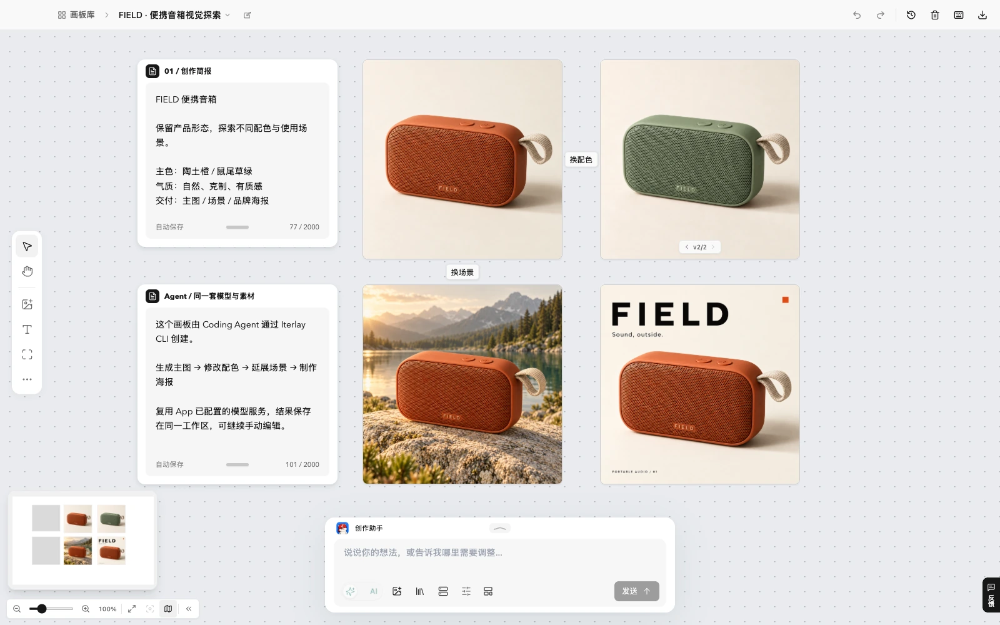
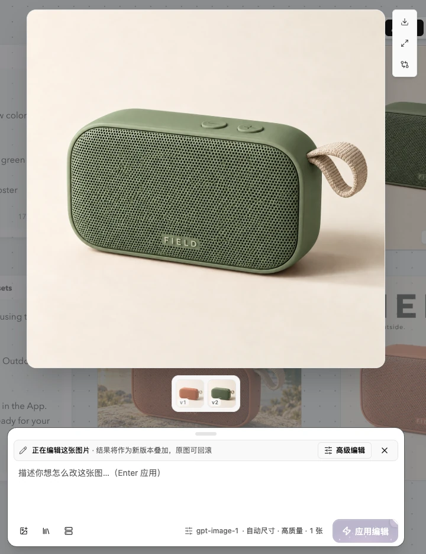
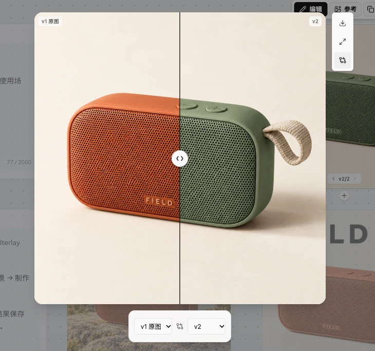

<div align="center">

# Iterlay

### 让灵感在画布上，一版版成为作品。

开源 AI 视觉创作工作台。把参考、图片生成、编辑和视频创作放进同一张无限画布，也让你的 Coding Agent 参与其中。

**自带模型 · 无限画布 · Agent 可操作 · MIT 开源**

[下载 Iterlay](https://github.com/Davied-H/iterlay/releases) · [官网](https://davied-h.github.io/iterlay/) · [接入 Agent](#让你的-agent-也能创作) · [English](README.md)

</div>



一台音箱，从产品主图到配色探索、户外场景与品牌海报。**参考、尝试和结果，都留在同一个创作空间里。**

本例由 Codex 通过 Iterlay CLI 调用 App 已配置的模型完成，截图来自当前网页工作台。查看[示例素材、提示词与制作说明](docs/readme-example.md)。

## 为什么用 Iterlay？

### 创作有上下文，迭代有来路

把参考图、生成结果和素材放在无限画布上，围绕一个项目持续探索。选中图片就能继续描述修改，用已有结果作为下一轮参考；版本比较与生成历史帮助你找回之前的方向。

### 模型由你选，配置可以复用

接入自己的 API Key 或 Codex 账号授权，按任务选择图片、视频和对话模型。在同一个工作台中使用不同供应商，Agent 也能复用 App 已保存的模型配置与授权。

### 你看画布，Agent 做执行

通过 CLI 和 Skill，让 Codex、Claude Code 等 Coding Agent 生成图片、修改素材、制作视频、整理画板并导出文件。你可以在画布上查看和调整结果，也可以让 Agent 将素材导出到正在开发的项目。

### 工作区保存在本地，工具开源免费

画板与素材保存在本机。桌面端、画布、AI 集成、CLI 和官网的原创代码均采用 MIT 许可证，可自行修改和构建。应用永久免费，无需激活；模型调用费用由对应供应商收取。使用远程模型时，提示词和所需参考素材会发送给所选服务。

## 从参考到成品，连起来做

### 1. 带着参考开始

导入已有图片，或直接输入提示词生成。把风格参考、产品图和候选方案放在一起，为下一步创作保留视觉上下文。

### 2. 在画布上继续修改

选中结果，描述想改变的背景、对象或风格，继续生成下一版。图片编辑助手会结合当前图片，帮助你明确修改目标与需要保留的内容。



### 3. 比较版本，再决定方向

同一张产品图从陶土橙改为鼠尾草绿，原图与修改版保留在同一节点中。拖动对比滑块检查变化，再决定采用哪一版。



### 4. 整理并交付素材

将图片切分为可复用素材，按画板和素材库整理，再导出用于设计或开发。需要动态内容时，还可以使用支持的模型进行文生视频或图生视频。

## 可以拿来做什么？

- **产品与电商视觉：** 从产品参考出发，探索场景、背景和光线，比较不同展示方案。
- **内容与品牌创作：** 生成海报、封面、社媒配图，把参考和候选方案集中在同一画板。
- **设计与开发素材：** 让 Coding Agent 生成插画、背景和图片素材，导出到项目继续使用。
- **视频概念探索：** 从文字或已有图片出发生成视频，与静态视觉一起组织。

## 开始使用

1. **下载安装。** 前往[下载页](https://davied-h.github.io/iterlay/#/download)选择系统版本；实际可用安装包以 [GitHub Releases](https://github.com/Davied-H/iterlay/releases) 为准。
2. **连接模型。** 在设置中添加供应商、API Key 和模型，或使用 Codex 账号授权。
3. **创建第一张画板。** 导入参考图或输入提示词，生成后选中结果继续修改。

### 支持哪些模型服务？

- **图片生成与编辑：** OpenAI 兼容接口、OpenRouter、阿里云百炼、火山方舟、Poe、fal.ai、Codex OAuth。
- **视频生成：** 火山方舟、fal.ai、OpenRouter、MiniMax。
- **对话与创作助手：** OpenAI 兼容接口、Codex OAuth。

三类能力分别配置。图片编辑、参考图、文生视频、图生视频及可用参数取决于具体模型与接口；接入某个供应商不代表它支持全部能力。Iterlay 不提供官方模型积分或代充值服务。

## 让你的 Agent 也能创作

给 Codex 或 Claude Code 一套能执行的视觉工具，让生成的素材进入你的实际工作流。

安装并打开 Iterlay、配置模型后，在 **设置 → Coding Agent** 中安装 Skill，或在终端运行：

```bash
npx iterlay add --agent codex
# 或：npx iterlay add --agent claude-code
```

然后向 Agent 提出具体任务，例如：

> 用 Iterlay 为 FIELD 便携音箱做一组视觉素材：先生成橙色产品主图，再探索绿色配色、户外场景和品牌海报。把结果整理在一个画板里，并导出到项目的 assets 目录。

App 首次打开时会自动安装随包 CLI。Agent 通过 Skill 调用 CLI，复用 App 中已保存的供应商与授权。当前版本使用 **CLI + Skill** 接入；迁移时会移除该 Agent 旧的 Iterlay MCP 配置。

也可以直接在终端使用：

```bash
iterlay image generate --prompt "暖色调、极简风格的咖啡杯插画" --out ./coffee.png --json
iterlay image edit --input ./coffee.png --prompt "把杯子改成米白色" --out ./coffee-light.png --json
```

更多用法见 [CLI 与 Agent 集成指南](cli/README.md)。

## 开发与贡献

需要 Node.js **22.12+** 与 **pnpm 10**；macOS 还需 Xcode Command Line Tools。

```bash
pnpm install
pnpm dev
```

在浏览器打开 **http://127.0.0.1:5180**，使用真实工作台进行开发。网页模式会启动隐藏的 Electron 后台服务，开发数据与正式 App 隔离。

[开发、检查与打包指南](docs/development.zh-CN.md) · [工程说明](docs/engineering.md) · [贡献指南](CONTRIBUTING.md)

欢迎通过 [Issues](https://github.com/Davied-H/iterlay/issues) 反馈问题和使用场景，或通过 Pull Request 参与改进。如果 Iterlay 对你有帮助，欢迎点一个 Star，或分享你的画板与创作过程，让更多人看到它能做什么。

## 许可证

项目原创代码采用 [MIT 许可证](LICENSE)。第三方依赖与资源遵循各自许可证，详见[第三方说明](THIRD_PARTY_NOTICES.md)。
