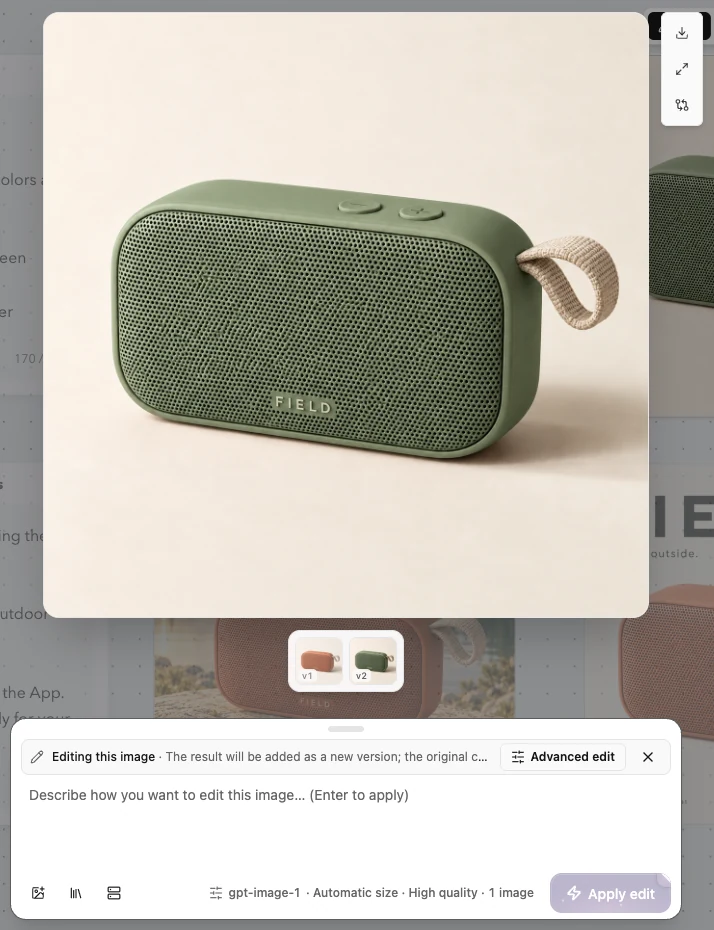
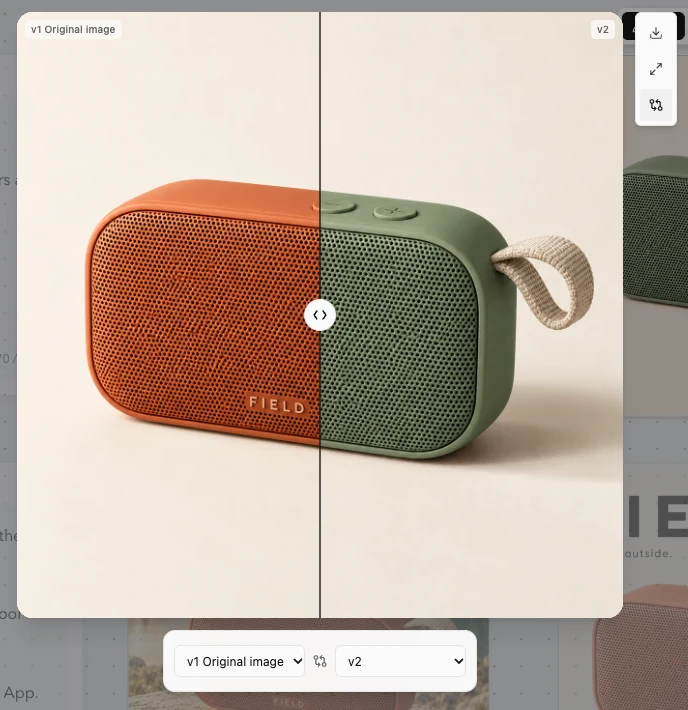
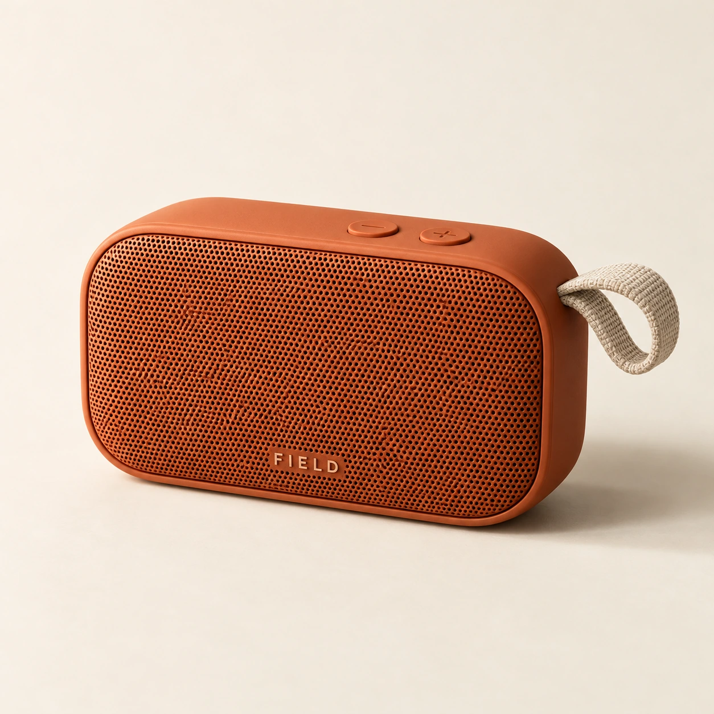
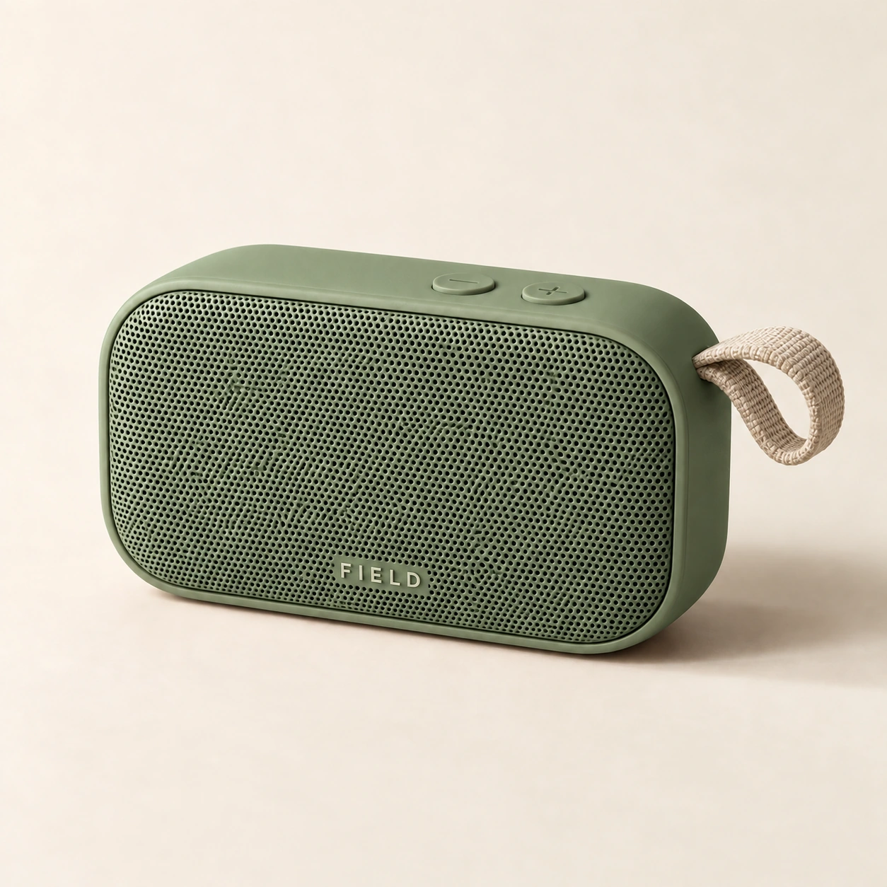
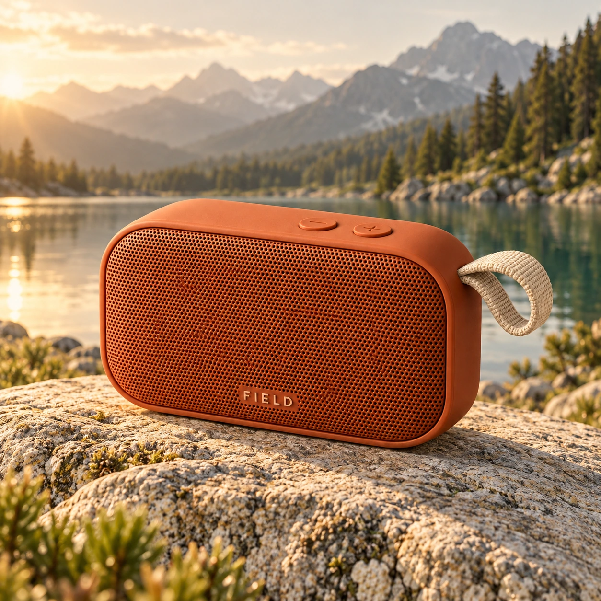
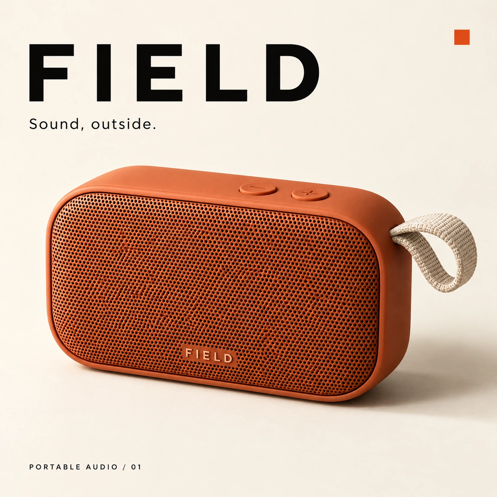

# Creative workflow and examples

[Back to README](../README.md)

### 1. Start with a reference

Import an existing image or generate one from a prompt. Keep style references, product images, and candidate directions together to guide your next step.

### 2. Refine on the canvas

Select a result and describe the background, object, or style you want to change. The image editing assistant uses the current image to help clarify what should change and what should stay.

### 3. Compare before you commit

Change the product from burnt orange to sage green while keeping the original and edited image in the same node. Drag the comparison slider to inspect the changes before choosing a version.

### 4. Set your image in motion

Choose an image you like and turn it into video with a supported model, or describe a scene to generate video from text. Keep images and videos on the same board as you explore.

### 5. Organize and deliver

Keep references, images, videos, and versions organized by project. Export the assets you need for product presentations, content, design, or development. Slice images into smaller reusable assets when needed.

## Made on this canvas

<table>
<tr>
  <td width="50%"> Product shot</td>
  <td width="50%"> Color edit</td>
</tr>
<tr>
  <td width="50%"> Outdoor scene</td>
  <td width="50%"> Brand poster</td>
</tr>
</table>

One product, four directions. These are real Iterlay outputs from the same example workflow; the green image is an edit of the orange original. [See the prompts and production notes](../docs/readme-example.md).

## What can you make?

- **Product and commerce visuals:** Explore scenes, backgrounds, and lighting from a product reference, then compare presentation options.
- **Content and brand assets:** Create posters, covers, and social graphics with references and candidate directions on the same board.
- **Assets for design and development:** Ask your coding agent to generate illustrations, backgrounds, and images, then export them into your project.
- **Image-to-video:** Turn a product image or scene into a moving version, then review and organize still and video assets together.
