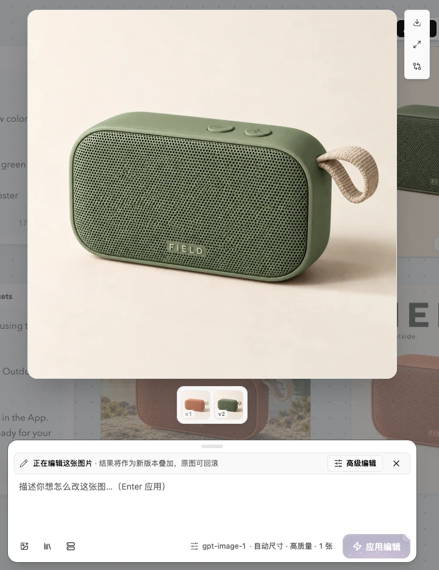
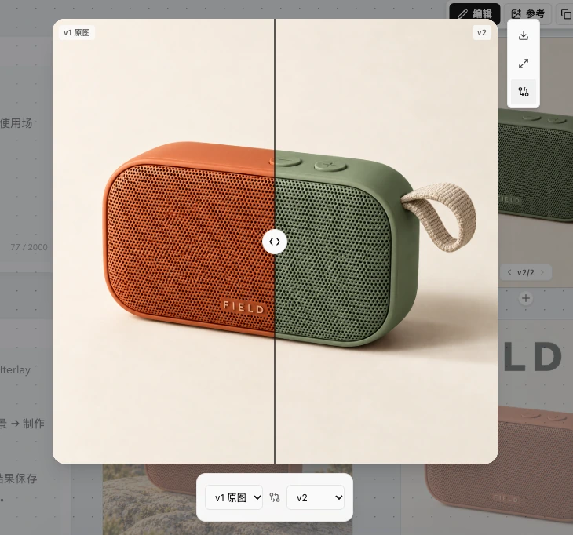
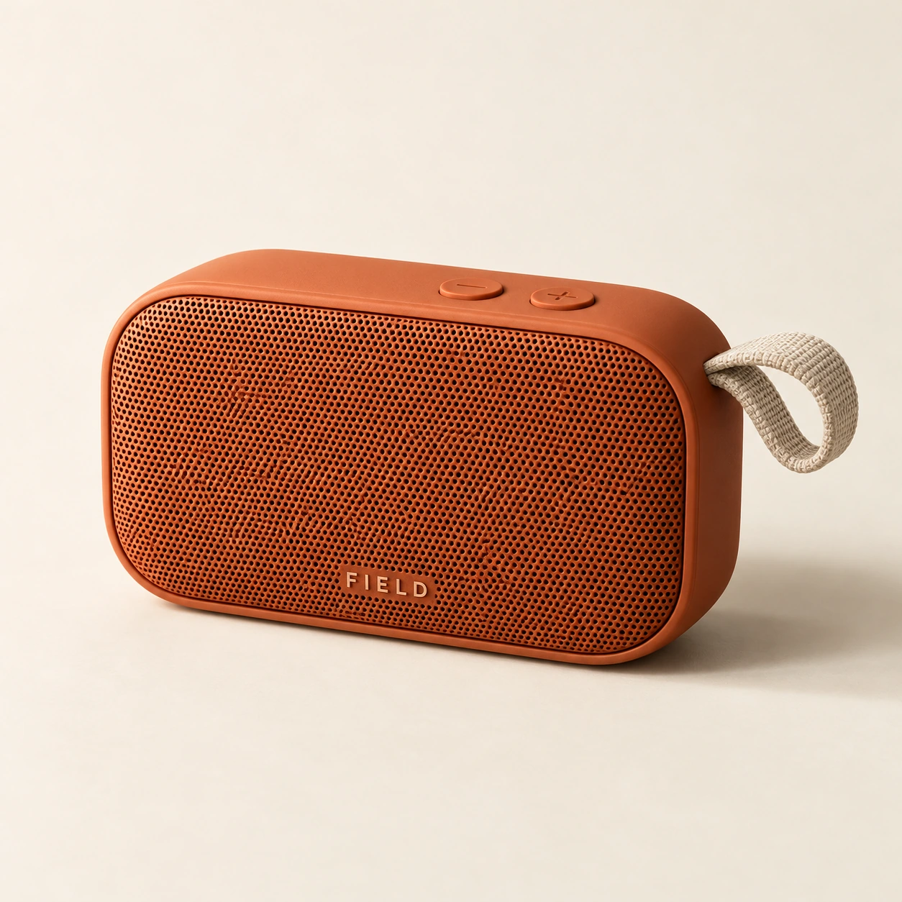
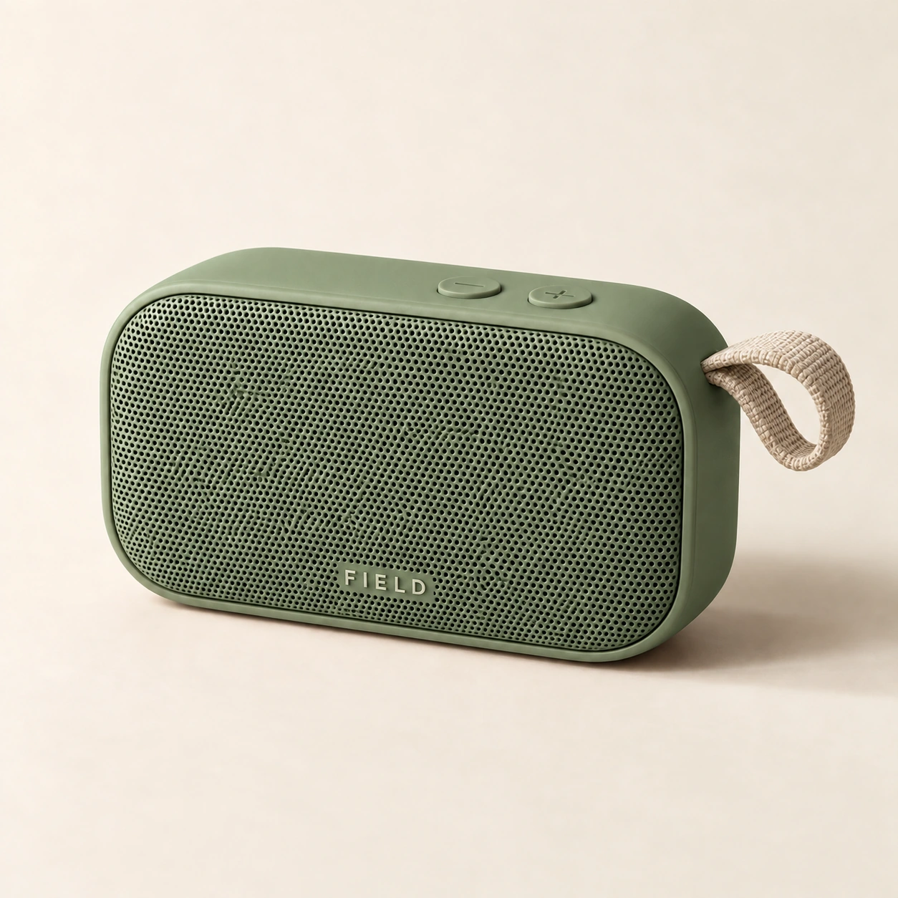
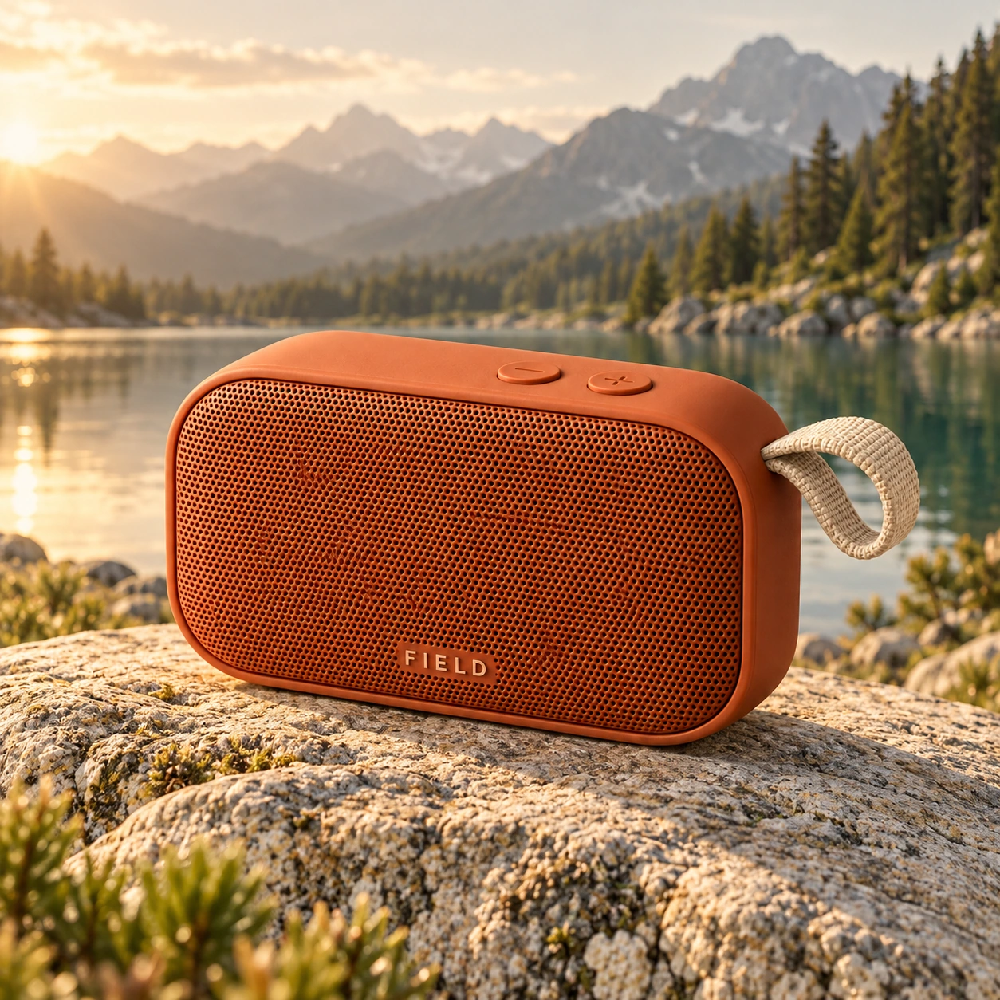
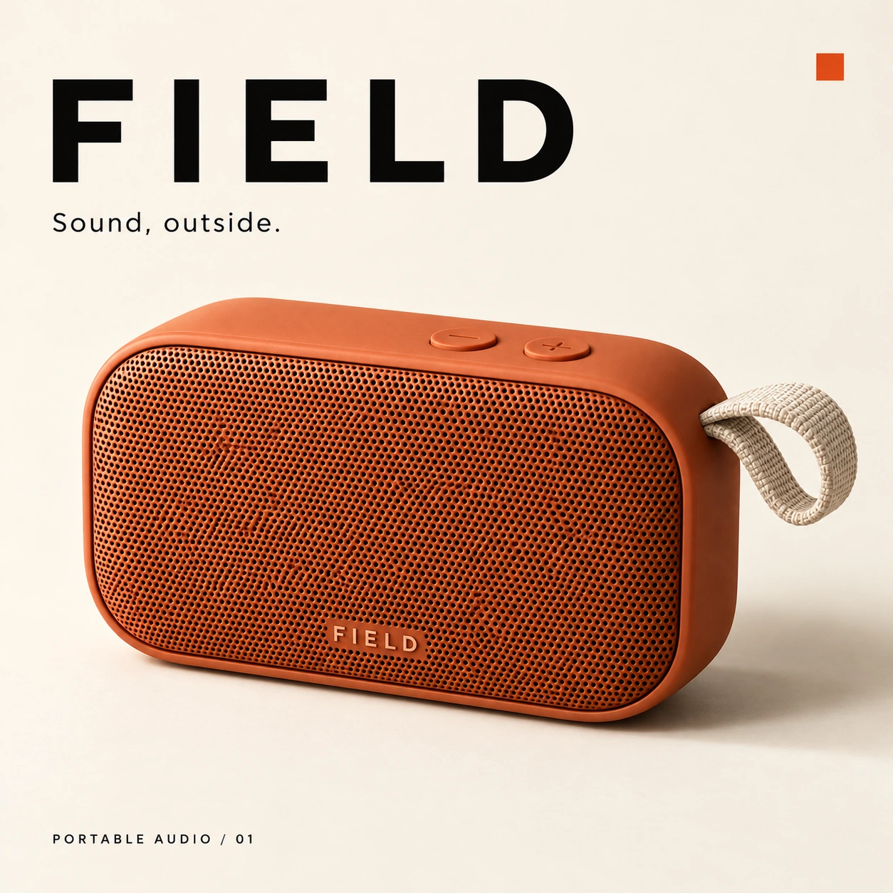

# 创作流程与案例

[返回 README](../README.zh-CN.md)

### 1. 带着参考开始

导入已有图片，或直接输入提示词生成。把风格参考、产品图和候选方案放在一起，为下一步创作保留视觉上下文。

### 2. 在画布上继续修改

选中结果，描述想改变的背景、对象或风格，继续生成下一版。图片编辑助手会结合当前图片，帮助你明确修改目标与需要保留的内容。

### 3. 比较版本，再决定方向

同一张产品图从陶土橙改为鼠尾草绿，原图与修改版保留在同一节点中。拖动对比滑块检查变化，再决定采用哪一版。

### 4. 让画面动起来

选一张满意的图片，用支持的模型生成视频；也可以直接用文字描述一段画面。图片和视频留在同一张画板，方便继续探索。

### 5. 整理好，再交付

把参考、图片、视频和不同版本按项目整理，导出需要的素材，用于产品展示、内容发布或设计开发。图片还可以切分为可复用的小素材。

## 在这张画布上做出的作品

<table>
<tr>
  <td width="50%"> 产品主图</td>
  <td width="50%"> 配色修改</td>
</tr>
<tr>
  <td width="50%"> 户外场景</td>
  <td width="50%"> 品牌海报</td>
</tr>
</table>

同一件产品，四种视觉方向。以上均为这次案例通过 Iterlay 实际生成的素材，绿色版本由橙色原图编辑得到。[查看提示词与制作说明](../docs/readme-example.md)。

## 可以拿来做什么？

- **产品与电商视觉：** 从产品参考出发，探索场景、背景和光线，比较不同展示方案。
- **内容与品牌创作：** 生成海报、封面、社媒配图，把参考和候选方案集中在同一画板。
- **设计与开发素材：** 让 Coding Agent 生成插画、背景和图片素材，导出到项目继续使用。
- **图片到视频：** 为满意的产品图或场景图生成动态版本，把静态和视频素材放在一起挑选、整理。
