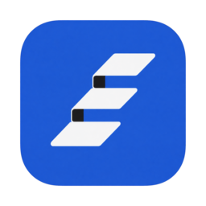
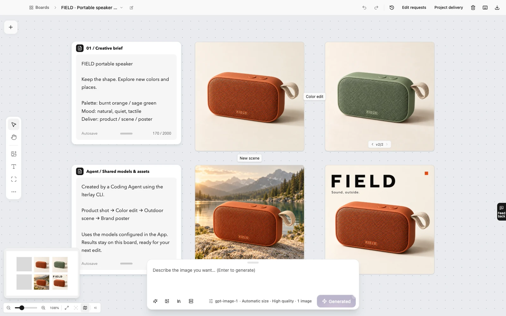

# Product story

[Back to README](../README.md)

# Iterlay

### Images, videos, and creative workflows. One canvas.

Iterlay is a free, open-source AI creative app. Generate images, refine the details, and make videos, with references, versions, and finished assets together on one canvas. Take an idea further without moving files between tools at every step.

**Images + video · Creative workflows · Your choice of models · Free & open source**

  
  
  
  
  
  

[Download Iterlay](https://github.com/Davied-H/iterlay/releases) · [Website](https://davied-h.github.io/iterlay/en/) · [Agent workflow & example](https://davied-h.github.io/iterlay/en/agents/) · [简体中文](../README.zh-CN.md)

One speaker, from a product shot to color exploration, an outdoor scene, and a brand poster. **Your references, experiments, and outputs stay together.**

Codex created this example through the Iterlay CLI using the App's configured model. Screenshots show the current browser workspace. See the [example assets, prompts, and production notes](../docs/readme-example.md).

## The story: From a whiteboard to a shared workspace for developers and agents

I'm a developer. Iterlay began with a straightforward wish: **I wanted somewhere as free-form as a whiteboard, where I could generate images and videos and gradually turn an idea into something real.**

Building a product involves more than code. A page needs imagery, a product needs a way to present itself, and a visual direction might lead to a short demo video. I wanted to work on those things around the project itself: references on one side, new experiments beside them, and room to keep developing the directions that felt right. Opening the workspace should let me see how an idea had taken shape.

### First, a whiteboard I could create on

What I like about a whiteboard is that I don't have to figure everything out before starting. I can put down a reference, write a few notes, and lay out several directions. I can step back to see the whole picture or focus on one image and keep working.

I wanted that freedom in AI creation. An image on the canvas should be something I could keep editing. An experiment worth keeping should have a version I could return to. A still image could become the starting point for a video. With text, images, and video in one space, the creative process would have a visible thread I could follow and revisit.

That was Iterlay's first starting point: bring generation into a whiteboard-style workspace, with somewhere to continue creating after the first result.

### Trying other tools revealed another missing piece

Along the way, I tried other whiteboard-style AI image tools. Laying out references and results on a canvas felt close to the way I wanted to work. But when it came time to generate something, I ran into a more immediate problem: **I knew what I wanted to make, but I wasn't good at writing professional prompts.**

As a developer, I can describe what a page needs and judge whether an image feels right. Translating that into composition, lighting, materials, and style instructions a model can follow is harder. The canvas gave me room to arrange ideas, but I still hesitated at the prompt box. How should I describe this? What information is missing? If the result is wrong, what should I change next?

I began to feel that Iterlay also needed an AI assistant I could think things through with. I wanted to start in my own words, have it help clarify the goal and ask about important details, and gradually turn a rough idea into actionable generation instructions. With references and results nearby, the conversation could keep building on them.

I wanted creation to begin with “I'd like to make something like this,” with the more specialized language taking shape through the conversation.

### A chance encounter brought Pi Agent into the picture

While thinking about this, I happened to come across Pi Agent, an agent tool that was attracting attention at the time. It made me wonder: could I bring it into Iterlay, so an assistant could work with the creative context, use the workspace's tools, and help me carry an idea forward?

I integrated Pi Agent and began building Iterlay's creative assistant around it. The whiteboard holds references, images, videos, and versions; the assistant provides a place to discuss ideas, clarify requests, and connect that conversation to tools.

That made the original whiteboard idea more complete. I wanted room to explore freely, and help figuring out the next step when I didn't know how to describe it or where to go from there.

### Then, I wanted to use it while writing code

As a developer, I also wanted to do this directly from coding agents, especially Codex and Claude Code.

When I'm building a page or implementing a feature with an agent, visual assets are already part of the task. I wanted to continue the same conversation: “Make an image that fits this page,” or “Create a few images and a video around this product direction.” The agent could use generation tools and bring the assets into the project, while I could open the canvas to review, compare, and decide what to change next.

Both ways of working mattered to me: the freedom to look and adjust things myself on a whiteboard, and the ability to ask an agent to use those same capabilities. The models I had chosen, the references I had collected, and the results already created should carry across both.

### The canvas and the terminal became one workspace

The whiteboard, the need for a creative assistant, and the wish to generate assets directly from coding agents gradually came together as Iterlay.

In the App, I can arrange references, generate images, refine details, compare versions, and explore video. In Codex or Claude Code, an agent can use the CLI and Skills to call the configured models, create assets, organize boards, and export files into a development project. The work connects through the same local workspace.

I can find a visual direction on the canvas and ask an agent to continue making assets. Or I can ask the agent for several candidates, then return to the canvas to choose and refine them. I can move between visual judgment and tool execution as the task develops.

**That's why I'm building Iterlay: a whiteboard where I can generate images and videos, an AI assistant that helps me articulate my ideas, and tools that let my coding agents join in, making visual creation part of the development process.**

## Why Iterlay?

### Take an image further. Turn it into video.

Keep references, generated images, and videos on one infinite canvas. Create an image, refine it, then turn it into video with a supported model. Keep the assets together so you can pick up where you left off.

Creative workflows connect references, generation, edits, comparisons, and delivery. Work directly on the canvas, or let an agent handle individual steps.

### Choose your models. Reuse your setup.

Bring your own API keys or authorize a Codex account. Choose image, video, and chat models for different tasks, with multiple providers in one workspace. Agents can reuse the models and credentials already configured in the App.

### Bring your agent into the workflow.

Give Codex, Claude Code, and other coding agents CLI tools and a Skill to generate images, edit assets, create videos, arrange boards, and export files. Review and adjust results on the canvas, or have your agent export assets into the project you are building.

### Local workspace. Free, open-source tools.

Boards and assets are stored on your computer. Original code for the desktop app, canvas, AI integrations, CLI, and website is MIT licensed, so you can modify and build it yourself. The app is permanently free, with no activation required; model providers charge for their usage. When you use a remote model, prompts and required reference assets are sent to that provider.
