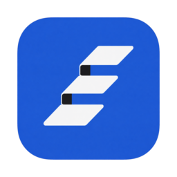
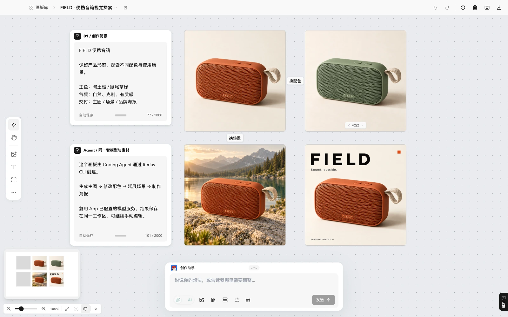

# 产品故事

[返回 README](../README.zh-CN.md)

# Iterlay

### 图片、视频与创作工作流，一张画布串起来。

Iterlay 是免费开源的 AI 创作 App。生成图片、修改细节、制作视频，再把参考、版本和成品整理在同一张画布上。从一个想法到一套素材，接着做，不用来回搬。

**图片 + 视频 · 创作工作流 · 自选模型 · 免费开源**

  
  
  
  
  
  

[下载 Iterlay](https://github.com/Davied-H/iterlay/releases) · [官网](https://davied-h.github.io/iterlay/zh/) · [Agent 工作流与案例](https://davied-h.github.io/iterlay/zh/agents/) · [English](../README.md)

一台音箱，从产品主图到配色探索、户外场景与品牌海报。**参考、尝试和结果，都留在同一个创作空间里。**

本例由 Codex 通过 Iterlay CLI 调用 App 已配置的模型完成，截图来自当前网页工作台。查看[示例素材、提示词与制作说明](../docs/readme-example.md)。

## 产品故事：从一张白板，到开发者与 Agent 共用的创作空间

我是一个开发者。Iterlay 最初来自一个很直接的愿望：**我想要一个像白板一样自由的地方，可以在里面生成图片、生成视频，把想法一点点做出来。**

开发一个产品，写代码只是其中一部分。页面里的配图、产品的展示图、一个想试试的视觉方向，甚至一段演示视频，都会成为创作的一部分。我希望这些东西能够围绕正在做的项目展开：参考图放在一边，新的尝试放在旁边，满意的方向继续往下做。打开工作区，就能看见这个想法是怎样一步步长出来的。

### 先有一张可以创作的白板

白板吸引我的，是它不要求人在开始之前就把一切想清楚。可以先放一张参考，写几句说明，再摆上几个不同的方向；退远一点看整体，也可以靠近一张图继续琢磨。

我想把这种自由带到 AI 创作里。画布上的图片应该能接着修改，某一次尝试值得保留，就留下一个版本；静态画面有了感觉，也可以沿着它继续生成视频。文字、图片和视频待在同一个空间里，创作过程就有了可以看见、可以回头的脉络。

这成为 Iterlay 的第一个出发点：把生成能力放到白板式的工作区里，让一次生成之后，还有地方继续创作。

### 试过其他工具后，我发现自己缺的还有一个助手

带着这个想法，我也体验了一些白板式的 AI 图片生成工具。把参考和结果铺在画布上，确实很接近我想要的创作方式。但真正开始生成时，我又遇到了一个更直接的问题：**我知道自己想做什么，却不太会写专业的提示词。**

作为开发者，我可以描述一个页面需要什么，也能判断一张图是不是自己想要的感觉。可要把这些想法变成模型容易理解的构图、光线、材质和风格描述，就没那么顺手了。画布给了我摆放想法的自由，提示词输入框前的犹豫却还在：应该怎么说？需要补哪些信息？结果不对，下一步又该改哪里？

我开始觉得，Iterlay 里还需要一个能一起商量的 AI 助手。我可以先用自己的话说出想法，它再帮我理清需求、追问关键细节，把模糊的感觉整理成可以执行的生成指令。参考和结果就在旁边，对话也能围绕它们继续。

我希望创作可以从“我想做一个这样的东西”开始，专业的表达则在交流中逐渐补齐。

### 一次偶然遇见，让 Pi Agent 加入了进来

就在思考这件事的过程中，我偶然看到了 Pi Agent。这个当时受到不少关注的 Agent 工具，让我开始琢磨：能不能把它接进 Iterlay，让助手结合创作上下文，使用工作台里的工具，陪我把一个想法往下做？

于是，我把 Pi Agent 加了进来，也开始围绕它搭建 Iterlay 的创作助手。白板承载参考、图片、视频和版本，助手则成为交流想法、梳理需求与衔接工具的入口。

这一步让最初的白板愿望更完整了：我既需要一个自由探索的空间，也需要有人在我不知道怎么描述、怎么继续的时候，帮我把下一步想清楚。

### 后来，我也希望在写代码的时候使用它

作为开发者，我还希望从 Coding Agent 里直接完成这些事，尤其是在 Codex 和 Claude Code 中。

当我正在和 Agent 一起开发一个页面，或者实现一个产品功能时，视觉素材本来就是任务的一部分。我希望能顺着当前的工作继续说：“帮这个页面做一张合适的配图”，或者“根据这个产品方向，做几张图片和一段视频”。Agent 能使用生成工具，把结果带回项目，我也能打开画布查看、比较，再决定下一步怎么改。

这里有两个同样重要的愿望：自己创作时，能在白板上自由地看和调整；交给 Agent 时，它也能操作同一套能力。已经选好的模型、已有的参考和生成结果，应该能在这两种使用方式之间接着用。

### 于是，画布和终端走进了同一个工作区

对白板的期待、对创作助手的需要，以及在 Coding Agent 中直接生成素材的愿望，逐渐汇成了现在的 Iterlay。

在 App 里，我可以亲自摆放参考、生成图片、修改细节、比较版本，继续探索视频；在 Codex、Claude Code 里，Agent 可以通过 CLI 与 Skill 调用已配置的模型，生成素材、整理画板，再把需要的文件导出到开发项目。两边的工作能够在同一个本地工作区里衔接起来。

我可以先在画布上找到一个视觉方向，再让 Agent 接着完成素材；也可以先让 Agent 生成几个候选，再回到画布里挑选和调整。需要亲自判断的时候看画布，需要执行的时候用工具，创作可以随着任务自然地来回切换。

**这就是我做 Iterlay 的原因：给自己一张能生成图片和视频的白板，一个能帮我把想法说清楚的 AI 助手，也给 Coding Agent 一套能参与其中的工具，让视觉创作真正成为开发过程的一部分。**

## 为什么用 Iterlay？

### 图片到视频，围绕同一个项目创作

把参考图、生成图片和视频放在同一张无限画布上。先做一张图，修改满意后，再用支持的模型生成视频。每一步的素材都留在项目里，方便接着创作。

创作工作流把参考、生成、修改、比较和交付连起来。你可以亲自操作，也可以让 Agent 接手其中的步骤。

### 模型自己选，配置可以复用

接入自己的 API Key 或 Codex 账号授权，按任务选择图片、视频和对话模型。在同一个工作台中使用不同供应商，Agent 也能复用 App 已保存的模型配置与授权。

### 也能交给 Agent，替你接着做

通过 CLI 和 Skill，让 Codex、Claude Code、WorkBuddy、Cursor、Windsurf、Cline、Roo Code、Gemini CLI、OpenCode 等 Coding Agent 生成图片、修改素材、制作视频、整理画板并导出文件。你可以在画布上查看和调整结果，也可以让 Agent 将素材导出到正在开发的项目。

### 工作区保存在本地，工具开源免费

画板与素材保存在本机。桌面端、画布、AI 集成、CLI 和官网的原创代码均采用 MIT 许可证，可自行修改和构建。应用永久免费，无需激活；模型调用费用由对应供应商收取。使用远程模型时，提示词和所需参考素材会发送给所选服务。
